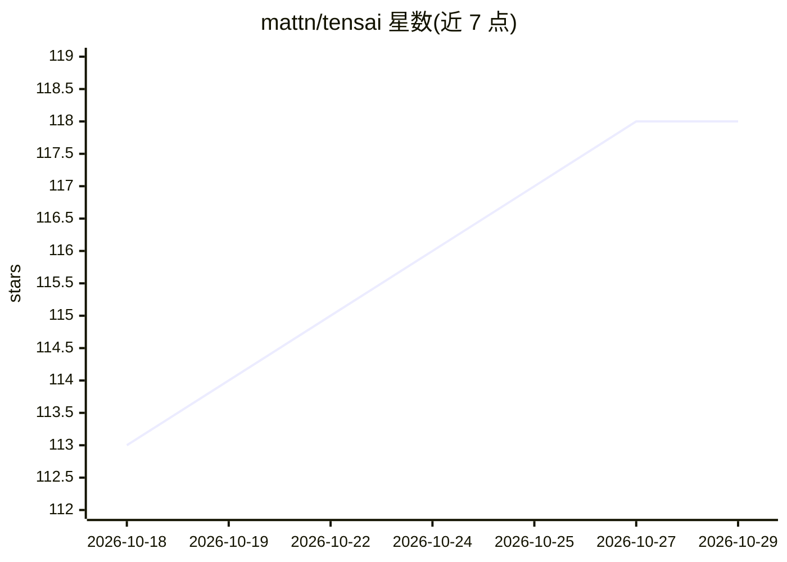

# mattn/tensai

⭐ 118 · Go · MIT · 推送 2026-10-09 · [GitHub](https://github.com/mattn/tensai) · [官网](https://mattn.github.io/tensai/) · 个人维护

**纯 Go 实现的轻量机器学习框架：张量/自动微分/量化与模型运行**

以纯 Go 编写的小型机器学习框架，供学习与实验使用。提供 N 维张量与广播运算、反向模式自动微分、常见层与优化器；SIMD 加速通过 Go 实验 SIMD 包实现 AVX2/NEON 内核，无 cgo。支持读取 safetensors 与 llama.cpp 的 GGUF 容器、加载 Hugging Face tokenizer，内置 int8/int4 权重量化，可用命令端到端运行 Qwen 图像生成、Qwen2-Audio 音频理解与文本嵌入（OpenAI /v1/embeddings 兼容服务）。另支持导出 ONNX/TFLite。限制：wgpu GPU 后端标注为实验性，SIMD 需特定 Go 版本与 GOEXPERIMENT 构建。

## 筛选速览

| 维度 | 判定 | 备注 |
|---|---|---|
| AI 角色 | `ai-ecosystem` | LLM/agent 周边工具 |
| 许可风险 | `permissive` | MIT |
| 部署形态 | `desktop` | 安装包/桌面程序 |
| 模型依赖 | local-ok | 支持本地模型 |
| 硬件要求 | — | 无带数字的原话,不猜 |
| 安装摩擦 | `low` | 无编译、无系统依赖或容器化 |
| 成熟度 | `idea` | |

## 能力要点

- 纯 Go 张量运算、自动微分与低分配训练循环，默认构建零外部依赖
- AVX2/NEON SIMD 内核与 int8/int4 权重量化
- 读取 safetensors/GGUF 检查点与 HF tokenizer.json，可端到端运行 Qwen 系模型
- 实验性 WebGPU 后端（purego，无 cgo）与 ONNX/TFLite 导出

## 适用场景

- 在 Go 项目中训练小型 MLP/卷积模型而不引入 cgo 依赖
- 在本地用命令行运行 Qwen 图像生成、音频理解或文本嵌入
- 将训练好的 Sequential 模型导出为 ONNX 或 TFLite 部署

## 场景标签

`推理引擎` `模型量化` `图像生成` · 领域:内容生成

## 证据(README 行号)

> L7: `tensai` is a small machine-learning framework for learning and experiments. It implements forward passes, backpropa
> L28: - **Automatic differentiation** - a micrograd-style reverse-mode autograd engine over n-dimensional tensors (`Param

## 星数曲线

2026-10-18 113 → 2026-10-29 118（+5）

---
*卡片 v1 · prompt 1.4 · 生成 2026-10-23 · 置信度 high · 依据 README sha `63920b324251` · [字段定义](../../DATASET.md)*
