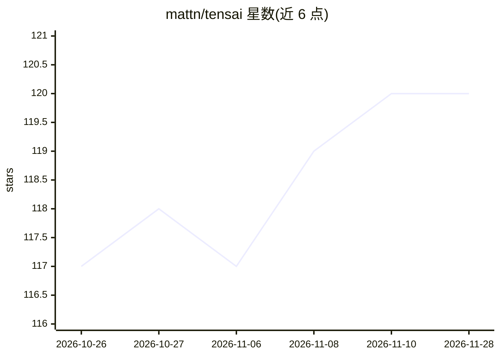

# mattn/tensai

⭐ 120 · Go · MIT · 推送 2026-11-06 · [GitHub](https://github.com/mattn/tensai) · [官网](https://mattn.github.io/tensai/) · 个人维护

**纯 Go 的小型机器学习框架：训练、推理与模型格式互操作**

面向学习与实验的 Go 语言机器学习框架，默认构建零外部依赖。核心机制：微 grad 风格反向传播 autograd 引擎、Sequential 模型（Compile/Fit/Predict）、AVX2/NEON SIMD 内核（GOEXPERIMENT=simd）、可选 WebGPU 后端（-tags wgpu）把批矩阵乘法卸载到 GPU。支持 int8/int4 量化、safetensors/GGUF/ONNX/TFLite 编解码、HuggingFace tokenizer 与 SentencePiece，并内置 Qwen-Image 文生图、Qwen2-Audio 音频理解与 ModernBERT 文本嵌入（tensai serve 提供 OpenAI /v1/embeddings 端点）。SIMD 构建需 Go 1.26/1.27 与实验特性开关。

## 筛选速览

| 维度 | 判定 | 备注 |
|---|---|---|
| AI 角色 | `ai-native` | 本体是模型或模型工具 |
| 许可风险 | `permissive` | MIT |
| 部署形态 | `desktop` | 安装包/桌面程序 |
| 模型依赖 | local-ok | 支持本地模型 |
| 硬件要求 | — | 无带数字的原话,不猜 |
| 安装摩擦 | `low` | 无编译、无系统依赖或容器化 |
| 成熟度 | — | 结构信号不足 |

## 能力要点

- 纯 Go 实现前向、反向传播与优化器（SGD/Adam/AdamW），默认无外部依赖
- AVX2/NEON SIMD 内核与可选 WebGPU 后端（Vulkan/Metal/D3D12，无 cgo）
- 读取 safetensors/GGUF（Q8_0、K-quants、MXFP4），导出 ONNX 与 TFLite
- 端到端运行 Qwen-Image 文生图、Qwen2-Audio 音频问答与 ModernBERT 嵌入

## 适用场景

- 在 Go 项目里训练小模型或做回归/分类实验
- 用纯 Go 加载并运行本地量化模型做文生图、音频理解
- 自托管 OpenAI 兼容的 embeddings 服务用于检索/RAG
- 把训练好的模型导出为 ONNX/TFLite 供其他运行时使用

## 场景标签

`图像生成` `模型量化` `推理引擎` · 领域:内容生成

## 证据(README 行号)

> L7: `tensai` is a small machine-learning framework for learning and experiments. It implements forward passes, backpropa
> L15: - **SIMD acceleration** - AVX2 kernels on amd64 and NEON (ARM's Advanced SIMD) kernels on arm64, written with Go's 
> L18: - **WebGPU backend (experimental)** - build with `-tags wgpu` (linux, macOS, Windows) and `gpu.Open()` runs batched

## 星数曲线

2026-10-26 117 → 2026-11-28 120（+3）

---
*卡片 v1 · prompt 1.4 · 生成 2026-11-28 · 置信度 high · 依据 README sha `1c5087111474` · [字段定义](../../DATASET.md)*
