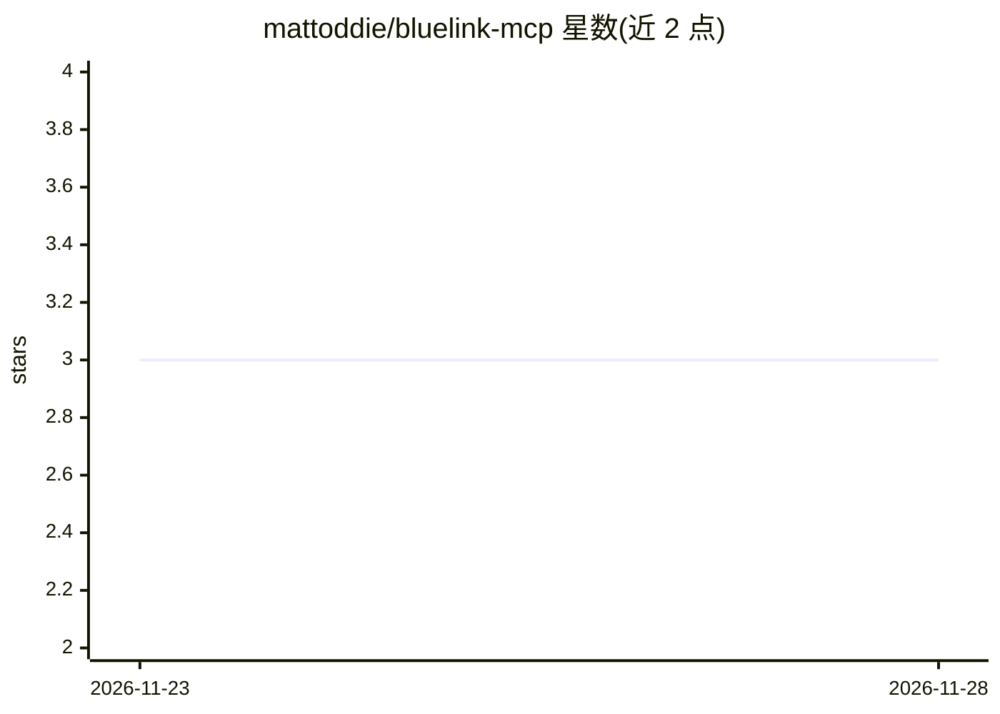

# mattoddie/bluelink-mcp

⭐ 3 · Python · MIT · 推送 2026-11-27 · [GitHub](https://github.com/mattoddie/bluelink-mcp) · [官网](https://bluelink-mcp.mattoddie.dev) · 个人维护

**让 Claude 等 AI 助手查询和控制现代/起亚车辆的 MCP 服务器**

基于 hyundai_kia_connect_api 库构建的 Model Context Protocol 服务器，向 AI 客户端暴露 20 余个车辆工具：读取电量/油量/续航/门窗锁/位置/行程/能耗，经权限开关后可执行锁车、关窗、空调预热、启停充电、设置充电计划等命令。默认只读，写入与解锁需独立环境变量开启，带按车限速、令牌缓存、审计日志与 MCP 安全注解。支持 Claude Desktop 一键扩展包、uv 源码运行与 Docker HTTP 部署。非官方项目，依赖厂商未公开 API。

## 筛选速览

| 维度 | 判定 | 备注 |
|---|---|---|
| AI 角色 | `ai-ecosystem` | LLM/agent 周边工具 |
| 许可风险 | `permissive` | MIT |
| 部署形态 | `self-host` | docker 或自建部署 |
| 模型依赖 | — | README 未给出锁定关系 |
| 硬件要求 | — | 无带数字的原话,不猜 |
| 安装摩擦 | `low` | 无编译、无系统依赖或容器化 |
| 成熟度 | — | 结构信号不足 |

## 能力要点

- 20 余个 MCP 工具覆盖车辆状态读取与远程控制
- 默认只读；写入与解锁需独立开关，命令按车限速
- 审计日志（JSON Lines）与 Bearer 令牌的 HTTP 传输安全机制
- 支持 Claude Desktop .mcpb 扩展包、uv stdio 与 Docker HTTP 三种部署

## 适用场景

- 在 Claude 里问车辆电量、续航、锁门状态与位置
- 语音/对话式预热车厢、启动充电、设置充电计划
- 通过 MCP Registry 让任意支持注册表的客户端接入车辆数据

## 场景标签

`AI 助手` · 领域:对话与助手

## 证据(README 行号)

> L7: An open-source Model Context Protocol server for **Hyundai Bluelink** and **Kia Connect** (formerly UVO). It lets Cl
> L55: ## Quick start

## 星数曲线

2026-11-23 3 → 2026-11-28 3（+0）

---
*卡片 v1 · prompt 1.4 · 生成 2026-11-23 · 置信度 high · 依据 README sha `ff889b18c0b1` · [字段定义](../../DATASET.md)*
