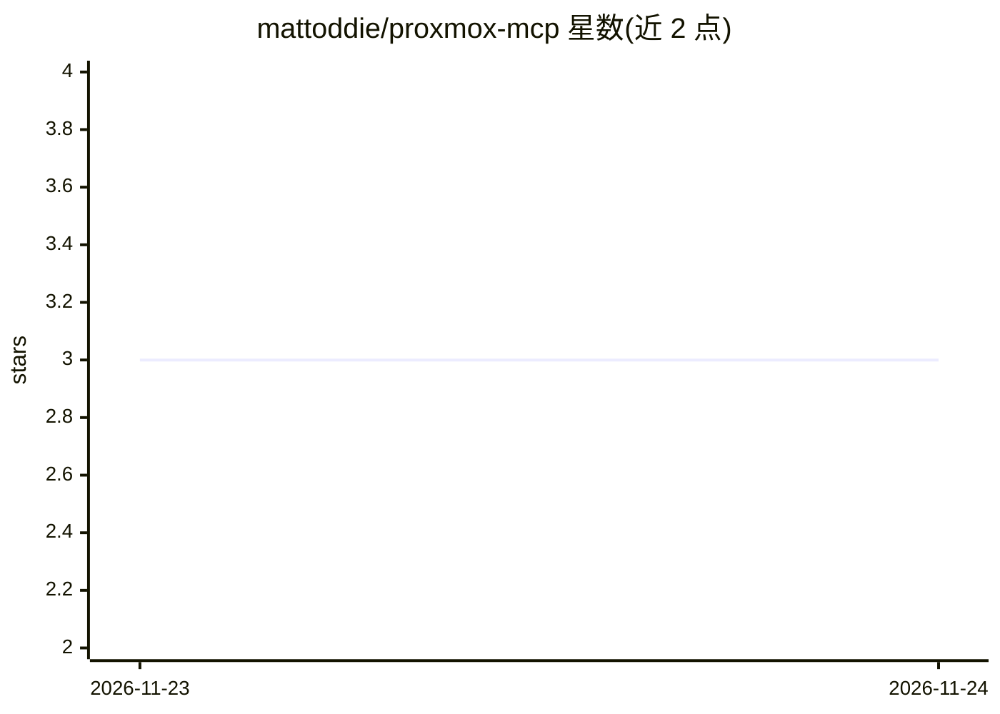

# mattoddie/proxmox-mcp

⭐ 3 · Go · MIT · 推送 2026-11-22 · [GitHub](https://github.com/mattoddie/proxmox-mcp) · [官网](https://proxmox-mcp.mattoddie.dev) · 个人维护

**让 AI 助手通过 MCP 监控管理 Proxmox VE 集群的服务器**

一个面向 Proxmox VE 的 Model Context Protocol 服务器，使 Claude 等支持 MCP 的 AI 助手能以自然语言查询和操作集群的节点、VM、LXC 容器、存储、备份、防火墙、HA、Ceph 等资源。默认只读，写入、删除、访客内执行需分别开启环境变量开关；变更支持 dry_run 预览并记录审计日志，输出中对密码与密钥脱敏。提供 19 个工具集、300+ 工具，通过 Docker 镜像、单文件二进制、brew 或一键 .mcpb 包运行。

## 筛选速览

| 维度 | 判定 | 备注 |
|---|---|---|
| AI 角色 | `ai-ecosystem` | LLM/agent 周边工具 |
| 许可风险 | `permissive` | MIT |
| 部署形态 | `self-host` | docker 或自建部署 |
| 模型依赖 | — | README 未给出锁定关系 |
| 硬件要求 | — | 无带数字的原话,不猜 |
| 安装摩擦 | `low` | 无编译、无系统依赖或容器化 |
| 成熟度 | — | 结构信号不足 |

## 能力要点

- 覆盖 19 个工具集、300+ 工具，含 raw API 逃生通道
- 默认只读；写入/删除/执行三级开关，支持 dry_run 与审计日志
- VMID 寻址：无需指定节点即可定位 VM 所在节点
- 提供 Claude Desktop 一键 .mcpb 包与 distroless Docker 镜像

## 适用场景

- 用自然语言巡检集群健康状态与备份覆盖情况
- 让 AI 助手执行 VM 克隆、迁移、快照清理等操作
- 审查用户、API token 与权限配置中的风险项
- 排查某台 VM 变慢的原因并查看任务日志

## 场景标签

`AI 助手` · 领域:对话与助手

## 证据(README 行号)

> L7: An open-source Model Context Protocol server for **Proxmox VE**. It lets Claude and other AI assistants monitor and 
> L35: - **🧰 Broad coverage.** It covers 19 toolsets: cluster, nodes, VMs, containers, guest agent, snapshots, storage, ba
> L44: You need Docker, a Proxmox VE 8 or 9 server or cluster, and an MCP client such as Claude Code.

## 星数曲线

2026-11-23 3 → 2026-11-24 3（+0）

---
*卡片 v1 · prompt 1.4 · 生成 2026-11-23 · 置信度 high · 依据 README sha `ce154de59018` · [字段定义](../../DATASET.md)*
