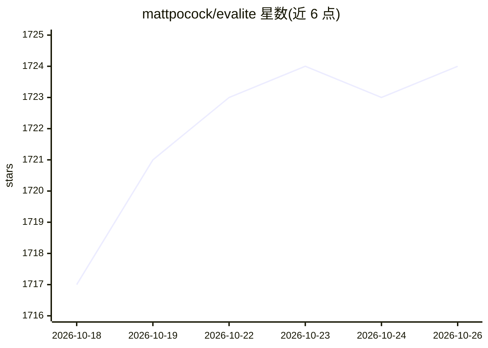

# mattpocock/evalite

⭐ 1,724 · TypeScript · MIT · 推送 2026-04-28 · [GitHub](https://github.com/mattpocock/evalite) · [官网](https://www.evalite.dev/) · 个人维护

**TypeScript 本地优先的 LLM 应用评测工具**

面向 TypeScript 开发者的 LLM 应用评测（evals）工具，定位为 TypeScript 原生、本地优先的测试方案，用于测试 LLM 驱动的应用。README 仅提供一句定位描述并附文档与 Discord 链接，未展示安装命令、运行方式或依赖说明，具体功能需查阅其文档确认。

## 筛选速览

| 维度 | 判定 | 备注 |
|---|---|---|
| AI 角色 | `ai-ecosystem` | LLM/agent 周边工具 |
| 许可风险 | `permissive` | MIT |
| 部署形态 | `None` |  |
| 模型依赖 | — | README 未给出锁定关系 |
| 硬件要求 | — | 无带数字的原话,不猜 |
| 安装摩擦 | `low` | 无编译、无系统依赖或容器化 |
| 成熟度 | — | 结构信号不足 |

## 能力要点

- TypeScript 原生的 LLM 应用评测工具
- 本地优先（local-first）运行方式

## 适用场景

- TypeScript 项目中对 LLM 应用输出做评测
- 在本地环境运行 LLM 应用的测试流程

## 场景标签

`模型评测` · 领域:评测与运维

## 证据(README 行号)

> L1: Evalite: the TypeScript-native, local-first tool for testing LLM-powered apps.

## 星数曲线

2026-10-18 1,717 → 2026-10-26 1,724（+7）

---
*卡片 v1 · prompt 1.4 · 生成 2026-10-21 · 置信度 low · 依据 README sha `89aedc03306d` · [字段定义](../../DATASET.md)*
