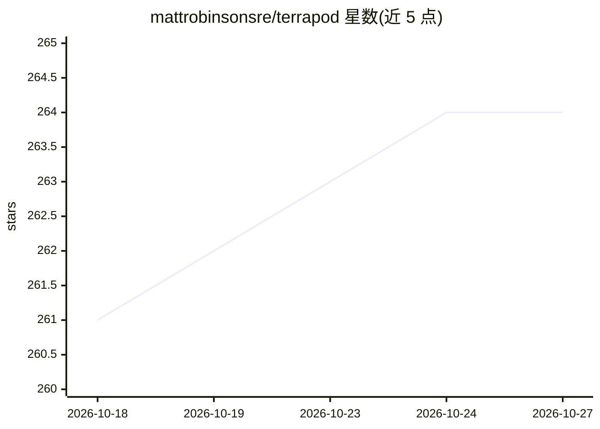

# mattrobinsonsre/terrapod

⭐ 264 · Python · MPL-2.0 · 推送 2026-10-26 · [GitHub](https://github.com/mattrobinsonsre/terrapod) · 组织维护

**自托管的开源 Terraform Enterprise 替代平台，供 IaC 团队使用**

面向标准化使用 Terraform/OpenTofu/Terragrunt（并兼容 Pulumi、Ansible）的团队的自托管 TACOS 平台，实现 CLI 实际消费的 TFE V2 API 子集，现有 cloud block 可零代码迁移。功能覆盖版本化远程状态、标签 RBAC、OPA/Rego 策略、私有模块/Provider 注册表、成本估算、安全扫描，以及默认关闭的可选 AI 审查层（经 LiteLLM 提供商无关）。状态与凭据留在用户自有 Postgres/对象存储/K8s 工作负载身份中；唯一硬性要求是 Kubernetes，以单一 Helm release 部署，提供 make eval 一键本地评估，并提供自 TFE/HCP/Atlantis 的可回滚迁移工具。MPL-2.0，声明无商业版。

## 筛选速览

| 维度 | 判定 | 备注 |
|---|---|---|
| AI 角色 | `ai-enhanced` | 去掉 AI 部分产品仍成立 |
| 许可风险 | `permissive` | MPL-2.0 |
| 部署形态 | `library` | 以包/库形式分发 |
| 模型依赖 | local-ok | 支持本地模型 |
| 硬件要求 | — | 无带数字的原话,不猜 |
| 安装摩擦 | `low` | 无编译、无系统依赖或容器化 |
| 成熟度 | — | 结构信号不足 |

## 能力要点

- 实现 terraform/tofu CLI 消费的 TFE V2 API 子集，cloud backend 可零代码切换
- OPA/Rego 策略即代码、标签 RBAC、GPG 签名私有注册表与内置成本估算
- 默认关闭的 AI 审查层：计划变更摘要、风险评估、失败分析与运行问答（经 LiteLLM）
- 出站-only runner、provider 镜像与二进制缓存，支持受限网络/air-gap 部署

## 适用场景

- 从 Terraform Enterprise / HCP Terraform 迁移到自托管平台且保留 CLI 工作流
- 在自有 Kubernetes 上集中管理 Terraform/OpenTofu 的状态、权限与策略
- 在网络受限或 air-gap 环境中运行 IaC 流水线
- 审查 Terraform 计划时查看成本、策略、安全扫描与 AI 风险评估

## 场景标签

 · 领域:基础设施即代码/DevOps 平台

## 证据(README 行号)

> L81: - **An AI-augmented review layer** — optional and off by default — plan change-summaries, risk assessment, failure 
> L112: Three deliberate design foci set Terrapod apart, each with a doc to go deeper: **restricted-network & multi-cluste
> L7: **A free, open-source, self-hosted alternative to Terraform Enterprise and Terraform Cloud (HCP Terraform)** — a **T

## 星数曲线

2026-10-18 261 → 2026-10-27 264（+3）

---
*卡片 v1 · prompt 1.4 · 生成 2026-10-22 · 置信度 low · 依据 README sha `59b14b81c043` · [字段定义](../../DATASET.md)*
