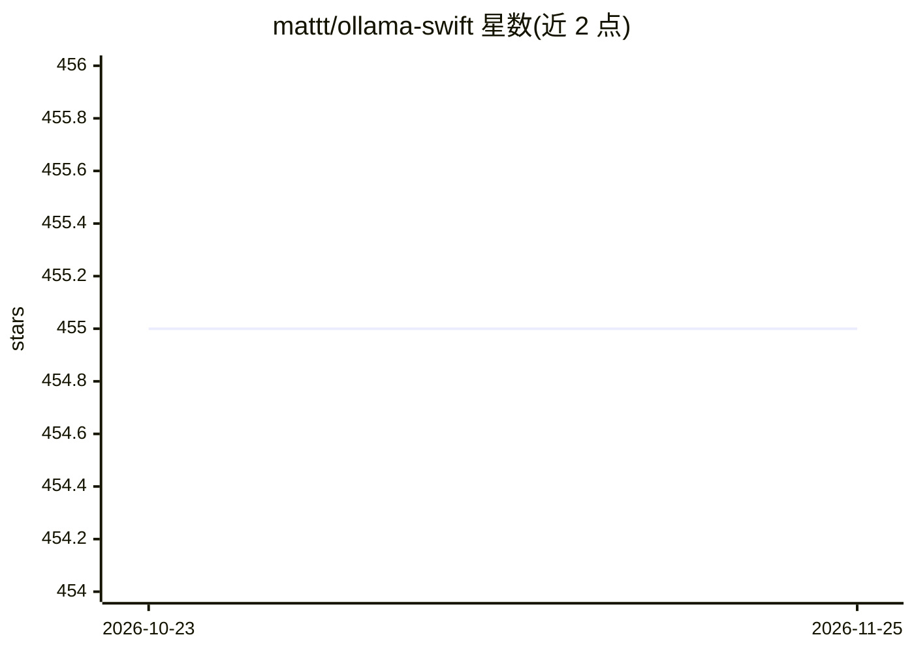

# mattt/ollama-swift

⭐ 455 · Swift · MIT · 推送 2026-11-02 · [GitHub](https://github.com/mattt/ollama-swift) · [官网](https://ollama.com) · 个人维护

**给 Swift 开发者接入 Ollama API 的客户端库**

一个 Swift 客户端库，封装 Ollama API 的交互：提供文本生成与流式输出、聊天补全、结构化输出（JSON/JSON Schema）、thinking 模式、工具调用（含多轮工具对话）、向量嵌入（单条与批量）、模型管理（列出/查询/拉取/推送模型）、keep-alive 内存控制以及 System One 决策问答。要求 Swift 5.7+、macOS 13+ 和本地运行的 Ollama，通过 Swift Package Manager 引入。

## 筛选速览

| 维度 | 判定 | 备注 |
|---|---|---|
| AI 角色 | `ai-ecosystem` | LLM/agent 周边工具 |
| 许可风险 | `permissive` | MIT |
| 部署形态 | `None` |  |
| 模型依赖 | local-ok | 支持本地模型 |
| 硬件要求 | — | 无带数字的原话,不猜 |
| 安装摩擦 | `low` | 无编译、无系统依赖或容器化 |
| 成熟度 | — | 结构信号不足 |

## 能力要点

- 支持文本生成与聊天的流式输出
- 支持结构化输出（JSON 与 JSON Schema）与 thinking 模型
- 支持工具调用及多轮工具对话
- 提供嵌入生成与模型列表/信息/拉取/推送管理

## 适用场景

- 在 Swift/macOS 应用中接入本地 Ollama 模型
- 为应用构建带工具调用的对话功能
- 批量生成文本嵌入向量
- 在代码中管理 Ollama 模型的下载与推送

## 场景标签

 · 领域:LLM 基础设施/客户端库

## 证据(README 行号)

> L3: A Swift client library for interacting with the
> L4: Ollama API.
> L10: - Ollama

## 星数曲线

2026-10-23 455 → 2026-11-25 455（+0）

---
*卡片 v1 · prompt 1.4 · 生成 2026-11-25 · 置信度 high · 依据 README sha `69c71ec029cd` · [字段定义](../../DATASET.md)*
