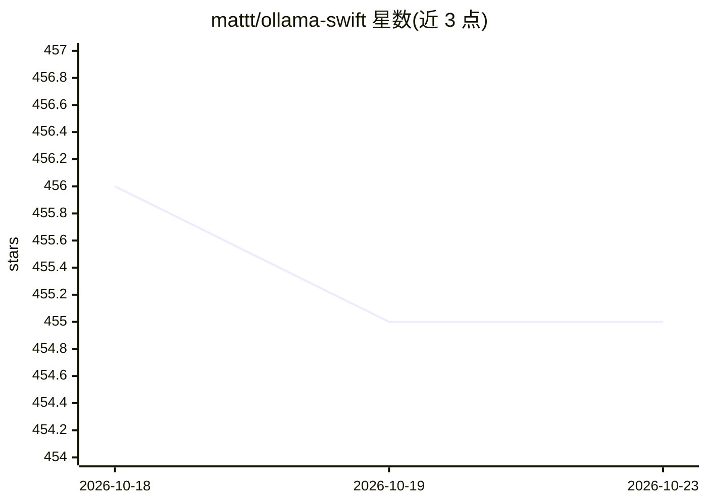

# mattt/ollama-swift

⭐ 455 · Swift · MIT · 推送 2026-10-16 · [GitHub](https://github.com/mattt/ollama-swift) · [官网](https://ollama.com) · 个人维护

**Swift 客户端库：在苹果平台调用 Ollama API**

以 Swift Package Manager 分发的 Ollama API 客户端库，面向 Swift 5.7+ / macOS 13+ 的苹果平台开发者。封装文本生成与流式生成、聊天补全、结构化输出（JSON / JSON Schema）、thinking 模式、keep-alive 模型内存控制、工具调用与多轮工具对话、文本嵌入（含批量）、System One 决策问答，以及模型列表/详情/拉取/推送管理。要求本机或可达的 Ollama 服务（默认 localhost:11434），部分功能如 System One 需 Ollama v0.35.0+。MIT 许可。

## 筛选速览

| 维度 | 判定 | 备注 |
|---|---|---|
| AI 角色 | `ai-ecosystem` | LLM/agent 周边工具 |
| 许可风险 | `permissive` | MIT |
| 部署形态 | `None` |  |
| 模型依赖 | local-ok | 支持本地模型 |
| 硬件要求 | — | 无带数字的原话,不猜 |
| 安装摩擦 | `low` | 无编译、无系统依赖或容器化 |
| 成熟度 | — | 结构信号不足 |

## 能力要点

- 文本/聊天生成与流式输出，支持 JSON 及 JSON Schema 结构化输出
- 工具调用与多轮工具对话，thinking 模式支持
- keepAlive 参数控制模型驻留内存时长
- 嵌入生成（单条与批量）及模型列表/拉取/推送管理

## 适用场景

- 在 macOS/iOS 应用中接入本地 Ollama 模型做聊天或生成
- 让 Swift 应用通过工具调用连接外部服务
- 批量生成文本嵌入构建检索功能

## 场景标签

 · 领域:LLM 基础设施/客户端库

## 证据(README 行号)

> L3: A Swift client library for interacting with the
> L4: Ollama API.

## 星数曲线

2026-10-18 456 → 2026-10-23 455（-1）

---
*卡片 v1 · prompt 1.4 · 生成 2026-10-21 · 置信度 high · 依据 README sha `2ca5bb19ea0c` · [字段定义](../../DATASET.md)*
