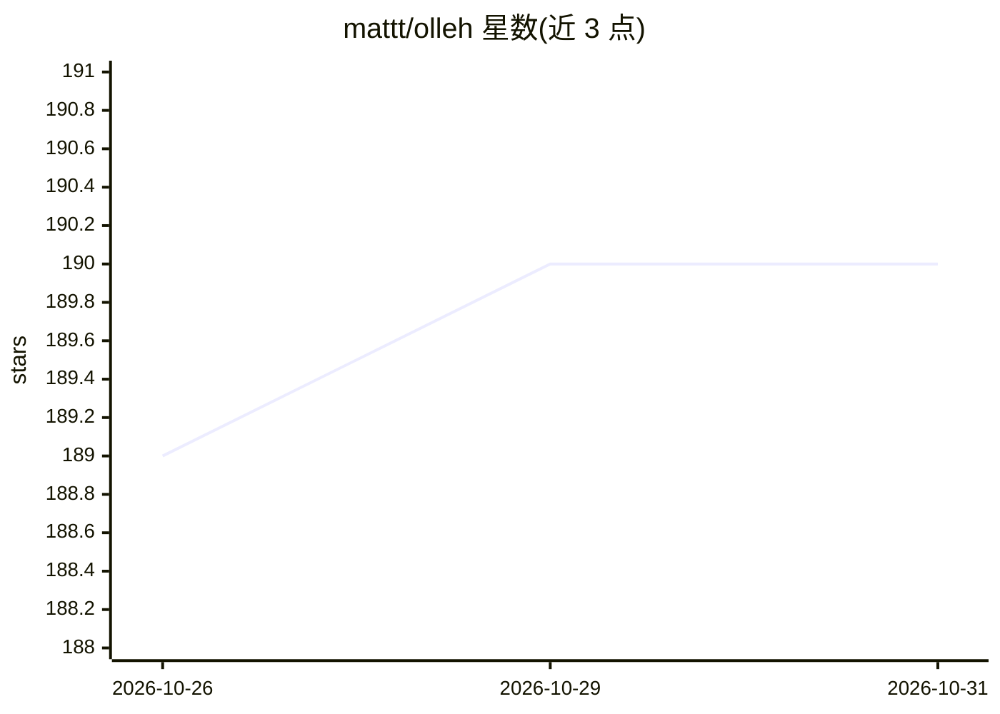

# mattt/olleh

⭐ 190 · Swift · MIT · 推送 2026-10-26 · [GitHub](https://github.com/mattt/olleh) · 个人维护

**让 Apple Foundation Models 通过 Ollama 兼容 API 使用的 CLI 桥接工具**

在 Apple Foundation Models（WWDC 2025 发布的系统内置模型）与 Ollama 生态之间提供桥接：以命令行与 HTTP API 两种形式暴露 Ollama 兼容接口（/api/generate、/api/chat、/api/tags 等，默认端口 11941），使已有的 Ollama 客户端与工作流可直接调用。目前仅支持 Foundation Models 的 default 一个模型，可通过 --adapter 加载自定义适配器做领域特化。要求 macOS 26 beta 及以上、Apple Silicon（M1+）与 Xcode 26 beta / Swift 6.2+。

## 筛选速览

| 维度 | 判定 | 备注 |
|---|---|---|
| AI 角色 | `ai-ecosystem` | LLM/agent 周边工具 |
| 许可风险 | `permissive` | MIT |
| 部署形态 | `None` |  |
| 模型依赖 | local-ok | 支持本地模型 |
| 硬件要求 | — | 无带数字的原话,不猜 |
| 安装摩擦 | `medium` | 含编译或系统依赖之一 |
| 成熟度 | — | 结构信号不足 |

## 能力要点

- Ollama 兼容的 HTTP API（generate/chat/tags/show/version）
- CLI 提供 serve/run/list/show/check 命令
- 支持加载 Foundation Models 自定义 adapter（.fmadapter）
- Homebrew 安装与源码编译两种途径

## 适用场景

- 让依赖 Ollama API 的现有工具直接调用 Apple 本地模型
- 在 Apple Silicon Mac 上本地运行命令行聊天会话
- 用自定义 adapter 特化 Foundation Models 后通过标准接口调用

## 场景标签

`推理引擎` `模型网关` · 领域:Agent 开发

## 证据(README 行号)

> L5: Olleh provides an Ollama-compatible API to Apple's new
> L8: It serves as a bridge between Apple's native AI capabilities and the
> L9: Ollama ecosystem, offering both a command-line interface and an HTTP API

## 星数曲线

2026-10-26 189 → 2026-10-31 190（+1）

---
*卡片 v1 · prompt 1.4 · 生成 2026-10-27 · 置信度 high · 依据 README sha `d02b38aa5955` · [字段定义](../../DATASET.md)*
