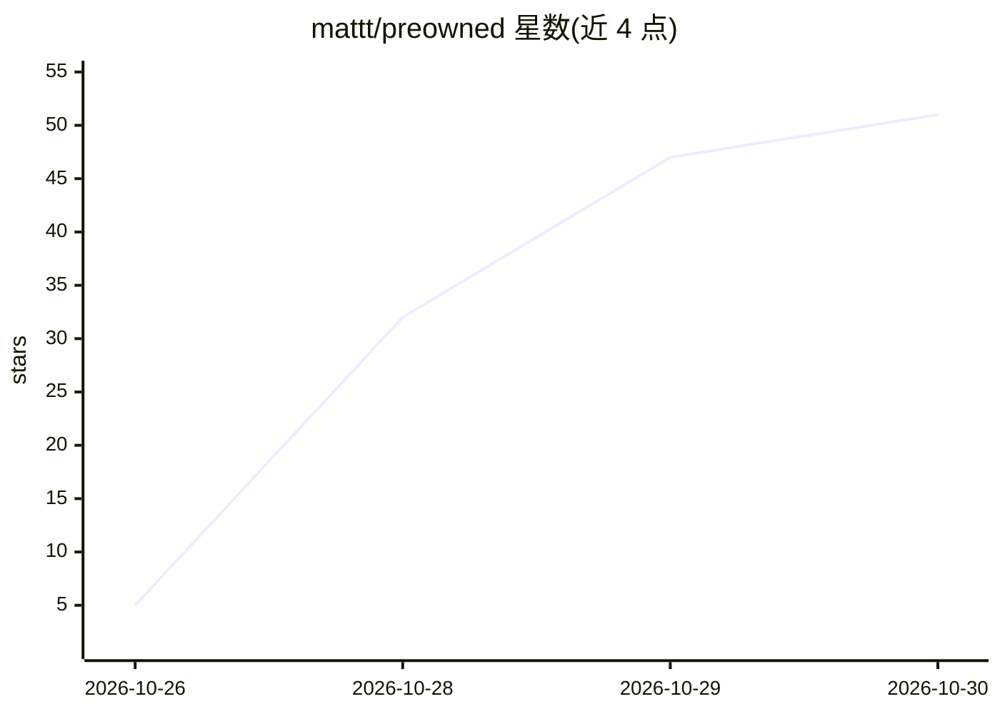

# mattt/preowned

⭐ 51 · Swift · MIT · 推送 2026-10-25 · [GitHub](https://github.com/mattt/preowned) · 个人维护

**把 macOS 内置模型包装成 OpenAI 兼容 API 的本地服务器**

用 Swift 编写的本地 HTTP 服务器，将 macOS 内置的 Foundation Models 聊天、Image Playground 图像生成、NaturalLanguage 嵌入、Speech 转录/合成、翻译等能力通过 OpenAI 兼容 API 暴露在 127.0.0.1:8027/v1，现有 OpenAI 客户端改 base_url 即可用。要求 Apple silicon、macOS 26+，聊天与图像需开启 Apple Intelligence。限制：不支持 tool calling、Responses API；图像在 macOS 27 需人工确认或 auto-approve 模式；MP3 需 lame 或 ffmpeg。通过 Homebrew 安装预编译包或 make 从源码构建。

## 筛选速览

| 维度 | 判定 | 备注 |
|---|---|---|
| AI 角色 | `ai-ecosystem` | LLM/agent 周边工具 |
| 许可风险 | `permissive` | MIT |
| 部署形态 | `None` |  |
| 模型依赖 | — | README 未给出锁定关系 |
| 硬件要求 | — | 无带数字的原话,不猜 |
| 安装摩擦 | `high` | 编译与系统依赖俱全 |
| 成熟度 | — | 结构信号不足 |

## 能力要点

- chat/embeddings/转录/翻译/语音合成/图像生成的 OpenAI 兼容端点
- 请求 gpt-4o 或 whisper-1 等模型名自动映射到对应 Apple 模型
- preowned inventory 命令列出本机可用模型及原因
- 支持 OPENAI_BASE_URL 环境变量，工具可零代码改动接入

## 适用场景

- 让现有 OpenAI SDK 工具直接调用 Mac 本地模型，不付费外部 API
- 在离线/本地环境跑聊天、嵌入、转录、语音合成
- 用 curl 或 Python/JS 客户端测试 Apple 内置模型能力

## 场景标签

`推理引擎` · 领域:训练与推理

## 证据(README 行号)

> L16: preowned is a local HTTP server that serves the models built into macOS
> L17: through the OpenAI API.

## 星数曲线

2026-10-26 5 → 2026-10-30 51（+46）

---
*卡片 v1 · prompt 1.4 · 生成 2026-10-28 · 置信度 high · 依据 README sha `6424e93d140a` · [字段定义](../../DATASET.md)*
