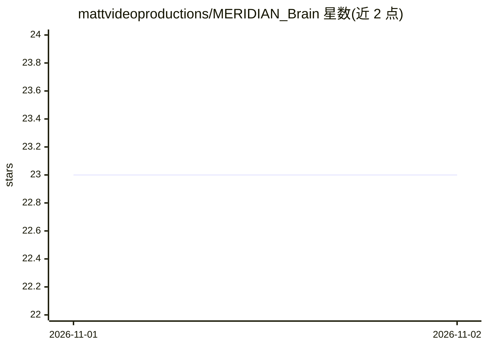

# mattvideoproductions/MERIDIAN_Brain

⭐ 23 · MIT · 推送 2026-10-30 · [GitHub](https://github.com/mattvideoproductions/MERIDIAN_Brain) · [官网](https://www.youtube.com/@MattVidPro) · 个人维护

**给任意 AI 聊天机器人加装持久记忆与人设的 Markdown 文件集**

一套以纯 Markdown 文件构成的"智能层"：把 brain/ 文件夹（入口为 MASTER_SPEC.md）作为上下文加载到 Claude、GPT、Gemini 等 AI 会话中，使该 AI 变为名为 Meridian 的实体，提供持久记忆、可切换人格模式（Base/Research/Creative 等）、实时行为滑杆（如"Set creativity to 90%"）与每条回复开头的认知状态面板。无需服务器或编码，复制文件即可使用；内置记忆修剪、事实/猜测标注等协议规则。

## 筛选速览

| 维度 | 判定 | 备注 |
|---|---|---|
| AI 角色 | `ai-knowledge` | 知识聚合/清单类 |
| 许可风险 | `permissive` | MIT |
| 部署形态 | `None` |  |
| 模型依赖 | — | README 未给出锁定关系 |
| 硬件要求 | — | 无带数字的原话,不猜 |
| 安装摩擦 | `low` | 无编译、无系统依赖或容器化 |
| 成熟度 | — | 结构信号不足 |

## 能力要点

- 纯 .md 文件实现，无需服务器或编码，兼容 Claude/GPT/Gemini 及本地工具运行器
- 持久记忆系统与自动记忆修剪（Auto-Gardening）
- 可切换人格模式与实时行为滑杆（含 Schema Mapping 程序化解析）
- 强制 [Fact]/[Speculation] 标注与置信度分级的研究输出协议

## 适用场景

- 让 ChatGPT/Claude/Gemini 在长会话中记住项目上下文与个人偏好
- 为自己的 AI 助手配置稳定一致的人格与行为参数
- 按模板自定义滑杆与人格模式，适配不同工作场景

## 场景标签

`提示工程` `AI 助手` · 领域:Agent 开发

## 证据(README 行号)

> L16: Instead of reinventing infrastructure, Meridian provides an **intelligence layer** via structured `.md` files that 
> L28: 1. Copy the `brain/` folder to your AI session

## 星数曲线

2026-11-01 23 → 2026-11-02 23（+0）

---
*卡片 v1 · prompt 1.4 · 生成 2026-10-31 · 置信度 high · 依据 README sha `fd75ffa363f9` · [字段定义](../../DATASET.md)*
