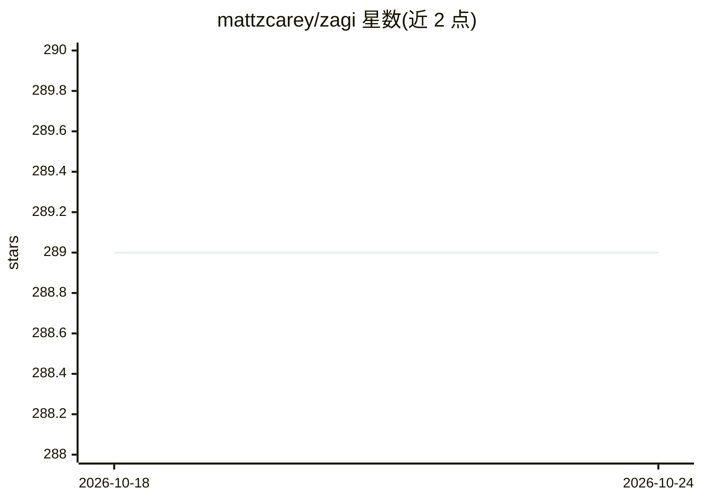

# mattzcarey/zagi

⭐ 289 · Zig · NOASSERTION · 推送 2026-04-07 · [GitHub](https://github.com/mattzcarey/zagi) · [官网](https://zagi.sh) · 个人维护

**面向 AI agent 的 git 命令行替代品，输出精简省 token**

用 Zig 实现的 git CLI 兼容替代品：实现 121 个 git 兼容命令，默认输出比 git 精简约 50% 以避免撑爆上下文窗口，提供 succinct/--compat/--json 三种输出模式，未实现的命令直接透传给 git。面向在 AI 编码工具中运行的 agent：自动检测 Claude Code/OpenCode/Cursor 等环境进入 agent 模式，支持 prompt 追踪、AI 提交归属（存于 git notes）、worktree 封装命令 fork、破坏性命令 guardrails。通过安装脚本下载二进制并设置别名，也可用 Zig 0.15 从源码构建。

## 筛选速览

| 维度 | 判定 | 备注 |
|---|---|---|
| AI 角色 | `ai-ecosystem` | LLM/agent 周边工具 |
| 许可风险 | `none` | NOASSERTION |
| 部署形态 | `None` |  |
| 模型依赖 | — | README 未给出锁定关系 |
| 硬件要求 | — | 无带数字的原话,不猜 |
| 安装摩擦 | `low` | 无编译、无系统依赖或容器化 |
| 成熟度 | — | 结构信号不足 |

## 能力要点

- 121 个 git 兼容命令，未实现的透传给 git
- 三种输出模式：succinct（默认省 token）、--compat（与 git 输出一致）、--json
- agent 模式：prompt 追踪与 AI 提交归属，元数据存于本地 git notes
- guardrails 可拦截 reset --hard / push --force 等破坏性命令，支持密钥覆盖

## 适用场景

- 让编码 agent 在有限上下文窗口内高效使用 git
- 追踪每个 commit 由哪个 AI agent 基于什么 prompt 生成
- 防止 agent 执行破坏性 git 命令
- 用 fork 命令为不同实现方案并行创建 worktree

## 场景标签

 · 领域:开发工具/git CLI

## 证据(README 行号)

> L3: > a better git interface for agents
> L89: Agent mode is automatically enabled when running inside AI tools (Claude Code, OpenCode, Cursor, Windsurf, VS Code)

## 星数曲线

2026-10-18 289 → 2026-10-24 289（+0）

---
*卡片 v1 · prompt 1.4 · 生成 2026-10-22 · 置信度 high · 依据 README sha `5b7b30d3235c` · [字段定义](../../DATASET.md)*
