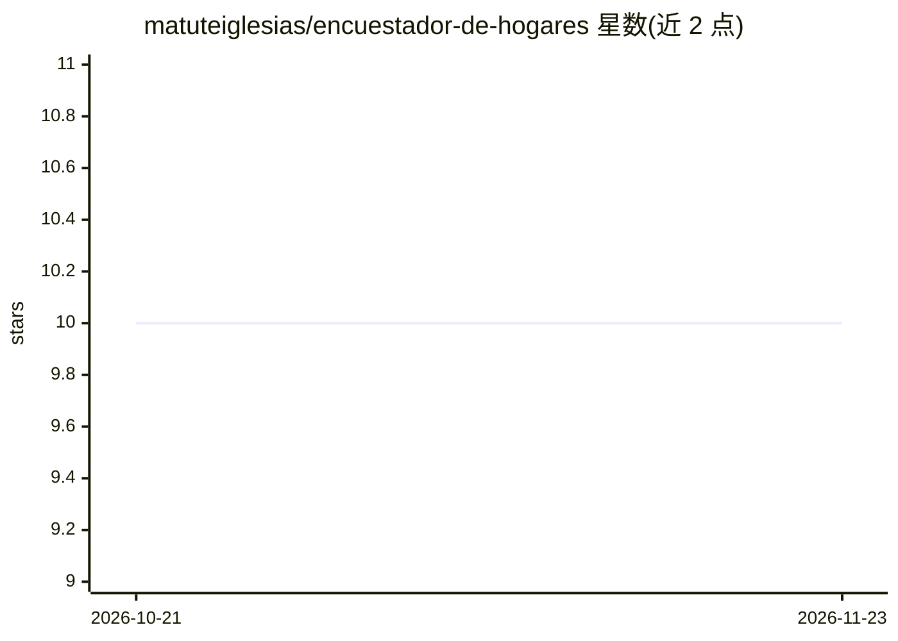

# matuteiglesias/encuestador-de-hogares

⭐ 10 · Jupyter Notebook · 推送 2026-10-25 · [GitHub](https://github.com/matuteiglesias/encuestador-de-hogares) · 个人维护

**阿根廷住户调查 ML 管线：由 EPH 证据推断目标期住户福利量**

作为统计桥梁，仓库以目标期 EPH（阿根廷常住户调查）证据和经批准的 EPH/Census 语义特征平面为输入，对精确 Census 派生住户样本推断住户福利量，输出可审计的假设、诊断与谱系（research.eph-census-transport-model / household-welfare 两类 artifact）。核心机制包括 household-aware OOF 中间预测、调查权重策略、每个 Census 特征的传输时间角色分类（donor_vintage_proxy 等），以及明确禁止位置/模糊连接。历史上限：明确声明不是预测或临近预测面，贫困线与 FGT 估计归相邻系统。

## 筛选速览

| 维度 | 判定 | 备注 |
|---|---|---|
| AI 角色 | `ai-native` | 本体是模型或模型工具 |
| 许可风险 | `none` | — |
| 部署形态 | `None` |  |
| 模型依赖 | — | README 未给出锁定关系 |
| 硬件要求 | — | 无带数字的原话,不猜 |
| 安装摩擦 | `low` | 无编译、无系统依赖或容器化 |
| 成熟度 | — | 结构信号不足 |

## 能力要点

- person-level hurdle 模型加显式年/季度/冲击修正的纵向测量路径
- household-aware OOF 中间预测与调查权重传输拟合/校准策略
- Census 特征按传输时间角色分类（donor_vintage_proxy、target_period_latent 等）
- C6 资源安全执行面：流式单折执行、确定性折叠持久化与断点重启

## 适用场景

- 用 EPH 季度数据推断 Census 样本住户在目标期的福利金额
- 为贫困估计系统提供带谱系与诊断的住户福利交接数据
- 研究调查数据向普查框架的时间传输（transport）方法学

## 场景标签

`数据分析` · 领域:效率与自动化

## 证据(README 行号)

> L10: > Given target-period EPH evidence, an approved EPH/Census semantic feature plane, one exact Census sample/scoring 
> L83: - honest household/group-aware out-of-fold intermediate predictions;
> L26: The centerline is a person-level hurdle over common-reference real `P47T`,

## 星数曲线

2026-10-21 10 → 2026-11-23 10（+0）

---
*卡片 v1 · prompt 1.4 · 生成 2026-11-19 · 置信度 mid · 依据 README sha `3040894d4ea4` · [字段定义](../../DATASET.md)*
