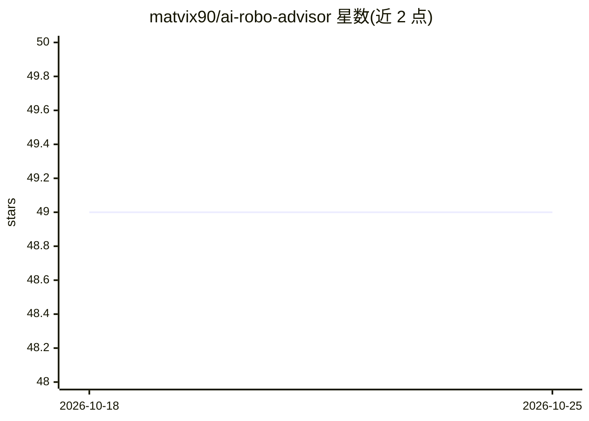

# matvix90/ai-robo-advisor

⭐ 49 · Python · MIT · 推送 2025-10-31 · [GitHub](https://github.com/matvix90/ai-robo-advisor) · 个人维护

**AI 多智能体 ETF 投资顾问：问卷生成组合并多维度分析**

基于 LangGraph 的多智能体投资助手：Investment Agent 通过问卷收集偏好并生成投资策略，Portfolio Agent 将策略转为最多 4 只 ETF 的组合，再由费用（TER）、分散化、风险对齐、业绩（CAGR、波动率、夏普比率等）等 Analyst Agent 分别分析，由 Orchestrator 汇总输出报告。需要 OpenAI（或 Google/Anthropic）API Key 与 Polygon.io 数据 Key。README 声明仅供教育与研究用途，非投资建议；免费 Polygon 限制组合至 4 只 ETF 和 2 年数据。提供 CLI（run-advisor）、pytest 测试套件与多阶段 Docker 环境。

## 筛选速览

| 维度 | 判定 | 备注 |
|---|---|---|
| AI 角色 | `ai-native` | 本体是模型或模型工具 |
| 许可风险 | `permissive` | MIT |
| 部署形态 | `library` | 以包/库形式分发 |
| 模型依赖 | — | README 未给出锁定关系 |
| 硬件要求 | — | 无带数字的原话,不猜 |
| 安装摩擦 | `low` | 无编译、无系统依赖或容器化 |
| 成熟度 | — | 结构信号不足 |

## 能力要点

- 多智能体分工：策略生成→ETF 组合构建→多维度分析→汇总报告
- 费用/分散化/风险对齐/业绩（CAGR、夏普比率、最大回撤、alpha、beta）四类分析 Agent
- CLI 运行并可用 --show-reasoning 展示 AI 推理过程
- 多阶段 Docker 环境（热重载、非 root 用户）

## 适用场景

- 用 AI 问卷生成 ETF 投资组合并获得分析报告
- 学习 LangGraph 多智能体架构在金融场景的应用
- 研究 AI 驱动的投资分析工作流（非实际投资建议）

## 场景标签

`金融量化` `多智能体` · 领域:Agent 开发

## 证据(README 行号)

> L13: **Multi-Agent System:**
> L27: - **AI-Driven Analysis** - Advanced market data analysis and strategy suggestions

## 星数曲线

2026-10-18 49 → 2026-10-25 49（+0）

---
*卡片 v1 · prompt 1.4 · 生成 2026-10-24 · 置信度 high · 依据 README sha `a389d784df46` · [字段定义](../../DATASET.md)*
