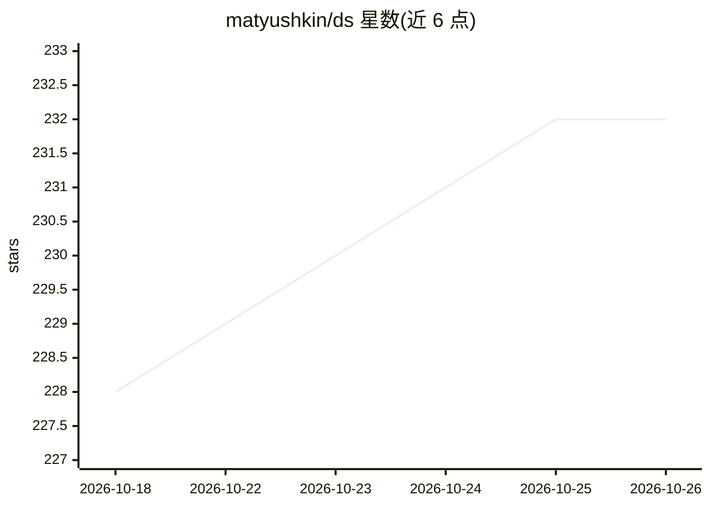

# matyushkin/ds

⭐ 232 · Jupyter Notebook · MIT · 推送 2026-03-02 · [GitHub](https://github.com/matyushkin/ds) · [官网](https://matyushkin.github.io/) · 个人维护

**俄语免费 Data Science 学习资源结构化清单**

由个人维护的俄语 Data Science 与机器学习免费资源聚合清单，以矩阵表格组织：行为 Data Science 各领域（机器学习、神经网络、计算机视觉、地理数据、NLP、金融分析、Big Data、LLM 与生成式 AI、MLOps、时间序列等），列为资源类型（课程、书籍、数据、文章、软件），交叉处链接到内部 README 文件。内容通过 pull-request 和 Telegram 群组协作补充更新，面向俄语学习者和从业者。

## 筛选速览

| 维度 | 判定 | 备注 |
|---|---|---|
| AI 角色 | `ai-knowledge` | 知识聚合/清单类 |
| 许可风险 | `permissive` | MIT |
| 部署形态 | `None` |  |
| 模型依赖 | — | README 未给出锁定关系 |
| 硬件要求 | — | 无带数字的原话,不猜 |
| 安装摩擦 | `low` | 无编译、无系统依赖或容器化 |
| 成熟度 | — | 结构信号不足 |

## 能力要点

- 按领域×资源类型组织的矩阵式目录结构
- 覆盖 10 余个 Data Science 子领域，含 LLM 与 MLOps
- 每个交叉点链接到独立的内部 README 文件
- 通过 pull-request 社区协作持续更新

## 适用场景

- 按领域系统查找免费的 Data Science 课程与书籍
- 寻找机器学习、NLP、计算机视觉等方向的开放数据集
- 了解俄语社区推荐的 Data Science 软件与工具库

## 场景标签

`精选清单` · 领域:学习与行业

## 证据(README 行号)

> L2: 👨‍🔬 In Russian: Обновляемая структурированная подборка бесплатных ресурсов по тематикам Data Science и Machine Learn
> L5: Разделы | 👨‍🏫 Курсы | 📚 Книги | 📊 Данные | 🙋‍♂️ Посты | ✊ Софт

## 星数曲线

2026-10-18 228 → 2026-10-26 232（+4）

---
*卡片 v1 · prompt 1.4 · 生成 2026-10-22 · 置信度 high · 依据 README sha `0edbd5a5fbae` · [字段定义](../../DATASET.md)*
