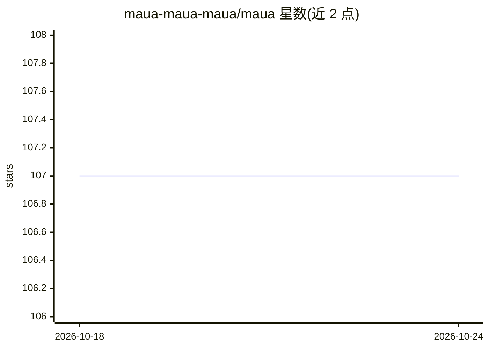

# maua-maua-maua/maua

⭐ 107 · Python · GPL-3.0 · 推送 2026-09-23 · [GitHub](https://github.com/maua-maua-maua/maua) · 组织维护

**深度学习图像/视频/音频合成的 Python 库与 CLI**

Maua 是一个 Python 库（含命令行接口），收集论文研究代码并将其整合为可组合的创意合成工具，覆盖扩散模型文生图、自回归模型（RuDALL-E）微调与生成、RealESRGAN 超分辨率等图像/视频/音频合成方法。CLI 功能均可通过 Python 导入使用。设计目标是可组合性，不同方法组合以扩展创作空间。安装需要 GPU 并先安装 CUDA，仅在 Ubuntu 20.04 与 NVIDIA GPU 上测试过，其他配置可能需要额外工作。主许可为 GPL-v3，部分组件可能适用其他许可。

## 筛选速览

| 维度 | 判定 | 备注 |
|---|---|---|
| AI 角色 | `ai-native` | 本体是模型或模型工具 |
| 许可风险 | `viral` | GPL-3.0 |
| 部署形态 | `library` | 以包/库形式分发 |
| 模型依赖 | — | README 未给出锁定关系 |
| 硬件要求 | — | 无带数字的原话,不猜 |
| 安装摩擦 | `medium` | 含编译或系统依赖之一 |
| 成熟度 | — | 结构信号不足 |

## 能力要点

- 扩散模型文本生成图像（classifier-free guided diffusion）
- RuDALL-E 自回归模型微训与生成
- RealESRGAN 图像超分
- CLI 与 Python API 双形式，方法可组合使用

## 适用场景

- 用一句话生成扩散模型图像
- 在自己的一组图像上微调自回归生成模型
- 批量超分放大生成图像

## 场景标签

`图像生成` `图像视频处理` `微调` · 领域:内容生成

## 证据(README 行号)

> L3: Maua is a Python library (and command line interface) for synthesizing images, video, and audio using deep learning.
> L36: python -m maua diffusion image --text "A street art mural of a dapper turtle with wings" --diffusion stable

## 星数曲线

2026-10-18 107 → 2026-10-24 107（+0）

---
*卡片 v1 · prompt 1.4 · 生成 2026-10-23 · 置信度 mid · 依据 README sha `3349b2646ec3` · [字段定义](../../DATASET.md)*
