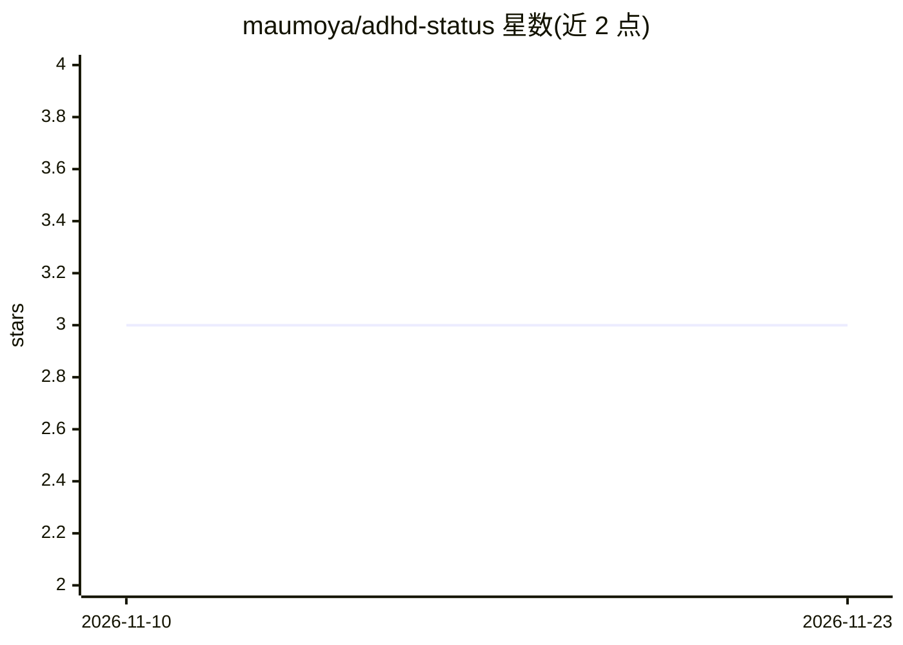

# maumoya/adhd-status

⭐ 3 · TypeScript · MIT · 推送 2026-11-22 · [GitHub](https://github.com/maumoya/adhd-status) · [官网](https://maumoya.github.io/adhd-status/progress.html) · 个人维护

**给 ADHD 开发者的 Claude Code 状态板 skill：一句 STATUS 出微型任务表**

以 SKILL.md 格式分发的 Claude Code skill/插件：会话中输入 STATUS，agent 扫描整段对话后回复一张固定 3 行的 Task|Why|Status 表与唯一一个下一步动作，内置完成检查防止承诺事项遗漏。支持 LEAF/MAIN/MASTER 三种模式、ROADMAP.md hub 模式与压缩提示，可选 python3 hooks 强制加载与回复格式校验，同一校验器可作 GitHub Action 在 CI 中检查回复文件。README 附带 plugin eval 与重问成本基准数据（自述小样本、LLM 评委）。MIT 许可，安装方式为 git clone 加符号链接或 /plugin 安装。

## 筛选速览

| 维度 | 判定 | 备注 |
|---|---|---|
| AI 角色 | `ai-native` | 本体是模型或模型工具 |
| 许可风险 | `permissive` | MIT |
| 部署形态 | `None` |  |
| 模型依赖 | — | README 未给出锁定关系 |
| 硬件要求 | — | 无带数字的原话,不猜 |
| 安装摩擦 | `low` | 无编译、无系统依赖或容器化 |
| 成熟度 | `idea` | |

## 能力要点

- 一句 STATUS 触发 3 行状态表与唯一下一步动作，内置对话完成检查
- LEAF/MAIN/MASTER 三模式与 ROADMAP.md hub 线程汇总机制
- 可选 python3 hooks 强制加载，校验器可作 GitHub Action 在 CI 运行
- README 附 eval 与重问成本基准数据及全部 episode 日志

## 适用场景

- 长线程 agent 会话中快速看清当前进度与下一步
- 多线程并行开发时用 /deck 面板查看各线程所需动作
- 在 CI 中自动校验 agent 状态回复的格式

## 场景标签

`编码 Agent` `提示工程` · 领域:Agent 开发

## 证据(README 行号)

> L19: **The free, open source ADHD-friendly status board for Claude Code and AI coding agents.** Say
> L27: An open source skill for Claude Code (and other agents that read `SKILL.md` skills, the open Agent
> L30: Say `STATUS` in any working session and you get:

## 星数曲线

2026-11-10 3 → 2026-11-23 3（+0）

---
*卡片 v1 · prompt 1.4 · 生成 2026-11-21 · 置信度 high · 依据 README sha `0f2f8761c909` · [字段定义](../../DATASET.md)*
