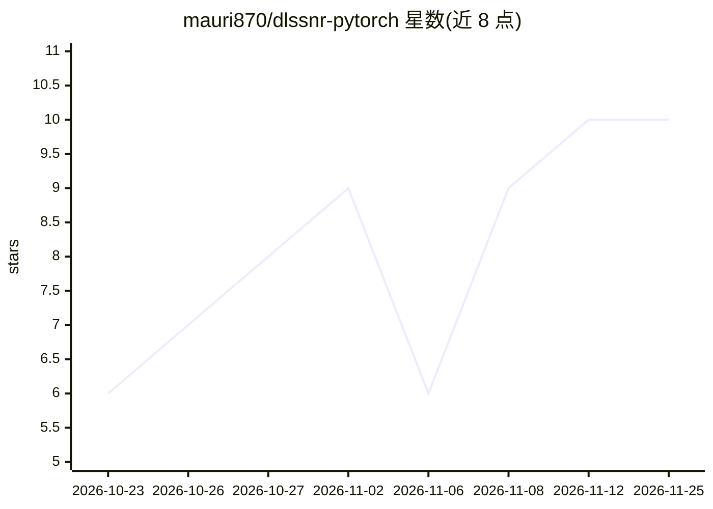

# mauri870/dlssnr-pytorch

⭐ 10 · Python · MIT · 推送 2026-10-16 · [GitHub](https://github.com/mauri870/dlssnr-pytorch) · 个人维护

**复现 NVIDIA DLSS 5 神经渲染网络的 PyTorch 参考实现**

从 NVIDIA 的 nvngx_dlssnr.dll 中提取网络权重（不加载运行该库），以 PyTorch 重建 DLSS 5 神经渲染网络，对相同输入复现 NVIDIA 输出至 45–49 dB PSNR。提供 extract/run/verify/plan 命令与 Python API，输出增强帧及 PSNR/SSIM 等校验指标；ROCm 构建附带 Triton 融合内核，另有可选的 int4 混合网络（移植自 DLSSNR-AMD）。需 Python 3.11+ 与 uv；权重须自行从 NVIDIA DLSS 5/NGX 包提取。

## 筛选速览

| 维度 | 判定 | 备注 |
|---|---|---|
| AI 角色 | `ai-native` | 本体是模型或模型工具 |
| 许可风险 | `permissive` | MIT |
| 部署形态 | `None` |  |
| 模型依赖 | — | README 未给出锁定关系 |
| 硬件要求 | — | 无带数字的原话,不猜 |
| 安装摩擦 | `medium` | 含编译或系统依赖之一 |
| 成熟度 | — | 结构信号不足 |

## 能力要点

- 从 nvngx_dlssnr.dll 字节级提取权重为 safetensors，不加载运行该库
- 复现 NVIDIA 输出至 45–49 dB PSNR，支持原始与 lighter 两种网络
- ROCm 构建的 Triton 融合内核，4K 单帧 0.77 s（7900 XTX）
- 可选 int4 混合网络，移植 DLSSNR-AMD 的量化方法与表格

## 适用场景

- 离线验证 NVIDIA DLSS 5 网络在任意输入帧上的输出
- 研究该神经渲染网络的层结构与量化算术
- 批量增强单帧图像并校验与参考输出的差异

## 场景标签

`图像视频处理` · 领域:感知与多模态

## 证据(README 行号)

> L3: NVIDIA's DLSS 5 neural rendering network ("DLSS-NR") in PyTorch.
> L5: The network takes a colour frame and the library's conditioning controls and returns the enhanced frame, reproducing
> L32: reference implementation in PyTorch, written to reproduce NVIDIA's output, not to be fast. A dedicated Vulkan port,

## 星数曲线

2026-10-23 6 → 2026-11-25 10（+4）

---
*卡片 v1 · prompt 1.4 · 生成 2026-11-19 · 置信度 high · 依据 README sha `db42aecd19d8` · [字段定义](../../DATASET.md)*
