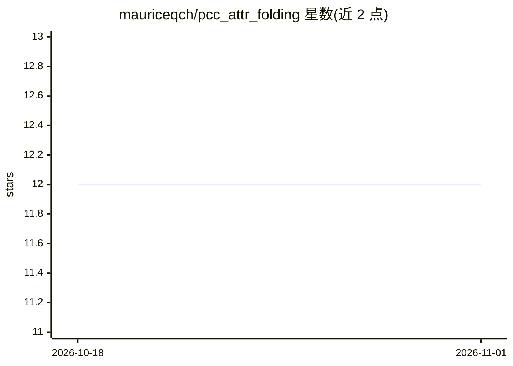

# mauriceqch/pcc_attr_folding

⭐ 12 · Python · MIT · 推送 2026-02-06 · [GitHub](https://github.com/mauriceqch/pcc_attr_folding) · 组织维护

**基于深度学习的点云属性压缩研究代码（论文复现）**

Université Paris-Saclay 团队发布的论文《Folding-based compression of point cloud attributes》配套实现：将点云划分为 patch，用神经网络把网格折叠拟合到点云上，再经 BPG 图像编码压缩属性，并与 MPEG G-PCC 结果做客观指标对比。提供预处理、训练、推理、评估、批量流水线等脚本，以及论文全部实验数据（模型、压缩结果、指标）。依赖 TensorFlow 1.15 + CUDA 环境，需编译 Chamfer Distance CUDA 核；G-PCC 相关组件需在 MPEG Gitlab 注册获取。

## 筛选速览

| 维度 | 判定 | 备注 |
|---|---|---|
| AI 角色 | `ai-native` | 本体是模型或模型工具 |
| 许可风险 | `permissive` | MIT |
| 部署形态 | `None` |  |
| 模型依赖 | — | README 未给出锁定关系 |
| 硬件要求 | — | 无带数字的原话,不猜 |
| 安装摩擦 | `high` | 编译与系统依赖俱全 |
| 成熟度 | — | 结构信号不足 |

## 能力要点

- 点云折叠 + BPG 编码的属性压缩完整流水线
- 与 MPEG G-PCC 的自动评估对比脚本（BD-RATE/BD-PSNR）
- 提供论文全部实验数据下载（模型、压缩结果、指标）
- 支持 patch 化与单点云两种运行方式

## 适用场景

- 复现论文的点云属性压缩实验结果
- 在自有点云数据上运行折叠压缩流水线并与 G-PCC 对比
- 研究基于学习的点云几何-属性映射方法

## 场景标签

 · 领域:三维点云压缩/计算机视觉研究

## 证据(README 行号)

> L129:  ├── 11_train.py [Train] Fold a grid onto a point cloud and save the obtained network
> L131:  ├── 20_gen_folding.py [Inference] Generate a folded grid with a trained network

## 星数曲线

2026-10-18 12 → 2026-11-01 12（+0）

---
*卡片 v1 · prompt 1.4 · 生成 2026-11-01 · 置信度 high · 依据 README sha `37ee90d63706` · [字段定义](../../DATASET.md)*
