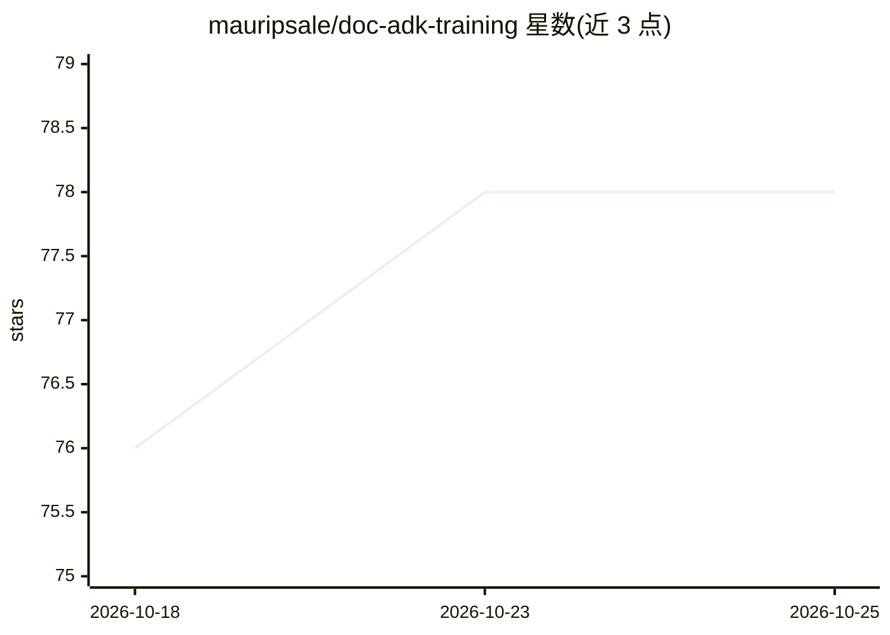

# mauripsale/doc-adk-training

⭐ 78 · Python · NOASSERTION · 推送 2026-10-24 · [GitHub](https://github.com/mauripsale/doc-adk-training) · 个人维护

**Google ADK 从入门到生产的 40 模块 AI agent 训练课程**

面向开发者的 Google Agent Development Kit (ADK) 多模块实操训练课程，覆盖 ADK 2.0 课程体系约 40 个模块：从基础环境搭建、首个 agent、工具与多模态，到多 agent 图工作流、评测与可观测性、MCP 集成、Cloud Run/GKE/Agent Runtime 部署与企业级 capstone 项目。由 Google Cloud 授权培训师/GDE 维护，随 ADK 版本（2.4-2.6）做经验性复验并修订。支持自学与讲师授课两种节奏，提供 Codespaces/Cloud Shell 一键云环境、DevContainer 与本地 uv 三种使用方式；本地设置需 Python 3.11+、gcloud 与启用计费的 Google Cloud 项目。

## 筛选速览

| 维度 | 判定 | 备注 |
|---|---|---|
| AI 角色 | `ai-knowledge` | 知识聚合/清单类 |
| 许可风险 | `none` | NOASSERTION |
| 部署形态 | `None` |  |
| 模型依赖 | — | README 未给出锁定关系 |
| 硬件要求 | — | 无带数字的原话,不猜 |
| 安装摩擦 | `low` | 无编译、无系统依赖或容器化 |
| 成熟度 | — | 结构信号不足 |

## 能力要点

- 约 40 个模块覆盖 ADK 2.0 全课程（基础→多 agent→生产部署→capstone）
- 提供自学(SS)与讲师授课(ILT)双时长估算及 1 天/2 天精简变体
- 随 ADK 2.4-2.6 版本做经验性复验并修复既有 bug
- GitHub Codespaces / Cloud Shell 一键零配置环境，另支持 DevContainer

## 适用场景

- 系统学习用 Google ADK 构建、测试与部署 AI agent
- 企业内训：按讲师授课时长安排 1-2 天工作坊
- 从零基础进阶到企业级多 agent 系统与 AgentOps 可观测性

## 场景标签

`教程课程` · 领域:学习与行业

## 证据(README 行号)

> L6: Welcome! This repository contains a comprehensive, multi-module training course for the **Google Agent Development K
> L61: ## ⏱️ Course Outline

## 星数曲线

2026-10-18 76 → 2026-10-25 78（+2）

---
*卡片 v1 · prompt 1.4 · 生成 2026-10-24 · 置信度 high · 依据 README sha `a7de1f183e60` · [字段定义](../../DATASET.md)*
