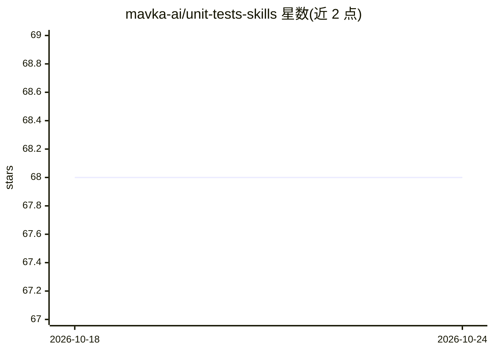

# mavka-ai/unit-tests-skills

⭐ 68 · Shell · MIT · 推送 2026-09-23 · [GitHub](https://github.com/mavka-ai/unit-tests-skills) · [官网](https://mavka.ai) · 组织维护

**给 AI agent 的 Java 单元测试生成技能包**

由 Mavka AI 维护的 agent skills 集合，为 Claude Code、Codex 及其他读取 AGENTS.md 的 agent 提供单元测试生成流程：先从代码分支规划 Given-When-Then 测试用例，再生成 Java 测试代码（JUnit 5 + Mockito + AssertJ），编译并运行后才报告完成。提供两个技能（generate-tests 全流程、generate-test-cases 仅规划），可通过 npx skills、openskills 或 Claude Code 插件市场安装。README 附带在 Spring Petclinic 上的 12 个注入缺陷对照基准，并声明结果可能因代码库与模型而异。仅支持 Java。

## 筛选速览

| 维度 | 判定 | 备注 |
|---|---|---|
| AI 角色 | `ai-ecosystem` | LLM/agent 周边工具 |
| 许可风险 | `permissive` | MIT |
| 部署形态 | `library` | 以包/库形式分发 |
| 模型依赖 | — | README 未给出锁定关系 |
| 硬件要求 | — | 无带数字的原话,不猜 |
| 安装摩擦 | `low` | 无编译、无系统依赖或容器化 |
| 成熟度 | — | 结构信号不足 |

## 能力要点

- Plan→Generate→Compile→Run 四步测试生成工作流
- Given-When-Then 格式的测试用例规划技能
- 强制测试规范：分支覆盖策略、命名约定、禁止 @SpringBootTest
- 三种安装途径：npx skills / openskills / Claude Code 插件

## 适用场景

- 为缺少测试的 Java 服务或控制器补充单元测试
- 在生成测试代码前先审查规划好的测试用例
- 让 agent 按统一命名与结构规则产出 JUnit 5 测试

## 场景标签

`代码生成` · 领域:编码与开发

## 证据(README 行号)

> L9:  These skills make your agent plan coverage first, generate focused Java unit tests,
> L170: |Generate Tests|`/generate-tests <target>`|`/unit-tests-skills:generate-tests <target>`|Full workflow, unattended:
> L199: - **Claude Code**: install as a plugin (Option 3) or with `npx skills`.

## 星数曲线

2026-10-18 68 → 2026-10-24 68（+0）

---
*卡片 v1 · prompt 1.4 · 生成 2026-10-24 · 置信度 high · 依据 README sha `9c2818655835` · [字段定义](../../DATASET.md)*
