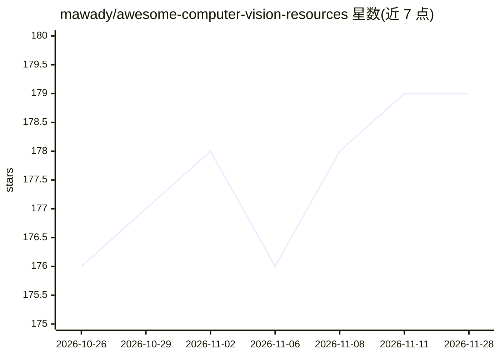

# mawady/awesome-computer-vision-resources

⭐ 179 · NOASSERTION · 推送 2026-11-13 · [GitHub](https://github.com/mawady/awesome-computer-vision-resources) · 个人维护

**为 CV 学习者提供按学习路径组织的资源策展清单**

以「策展优先于全面」为原则的计算机视觉学习参考清单，按基础图像处理→经典方法→深度学习→生成式模型的学习顺序组织资源。提供三条引导式学习轨道（含 Mermaid 路线图与逐轨大纲），分门别类收录 Python/Rust/MATLAB 库（带 active/legacy/archived 维护状态标注）、参考书目、19 门大学课程及按 CORE 排名分级的学术会议列表。

## 筛选速览

| 维度 | 判定 | 备注 |
|---|---|---|
| AI 角色 | `ai-knowledge` | 知识聚合/清单类 |
| 许可风险 | `none` | NOASSERTION |
| 部署形态 | `None` |  |
| 模型依赖 | — | README 未给出锁定关系 |
| 硬件要求 | — | 无带数字的原话,不猜 |
| 安装摩擦 | `low` | 无编译、无系统依赖或容器化 |
| 成熟度 | — | 结构信号不足 |

## 能力要点

- 三条引导式学习轨道与逐轨教学大纲
- 库条目带 ✅/⚠️/🗄️ 维护状态标注
- 会议列表按 CORE Ranking 分级并附收录率说明

## 适用场景

- 我想系统入门计算机视觉，需要按顺序的学习路线
- 我想挑选 CV 领域的参考书和公开课
- 我想了解 CV/ML 学术会议的等级分层

## 场景标签

`精选清单` `教程课程` · 领域:学习与行业

## 证据(README 行号)

> L11: There are dozens of "awesome computer vision" repositories on GitHub. Most are
> L16: This list is built around a different idea: **curation over comprehensiveness**.
> L26: Rather than browsing alphabetically, use the roadmap below to follow a structured progression from pixel math to mo

## 星数曲线

2026-10-26 176 → 2026-11-28 179（+3）

---
*卡片 v1 · prompt 1.4 · 生成 2026-11-27 · 置信度 high · 依据 README sha `b4e2e5c6f45d` · [字段定义](../../DATASET.md)*
