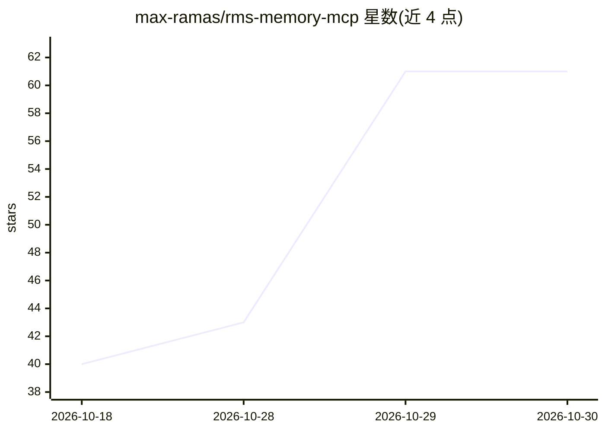

# max-ramas/rms-memory-mcp

⭐ 61 · Rust · MIT · 推送 2026-10-28 · [GitHub](https://github.com/max-ramas/rms-memory-mcp) · [官网](https://rms-ds.com/) · 个人维护

**给 AI 编码 agent 的本地跨 IDE 持久记忆 MCP 服务器**

Rust 实现的 MCP 记忆服务器：以集中式 Markdown vault 为唯一事实来源，供 Cursor、Zed、Claude Code 等任意 MCP 兼容 IDE 读写。检索采用 LanceDB 向量搜索 + Tantivy 全文搜索的混合方案（fastembed + multilingual-e5-small 默认嵌入，可切换本地 Ollama 模型），支持 Tree-sitter 代码索引、知识图谱、跨项目联邦搜索、会话 checkpoint 与 git 文件历史。本地优先、零云依赖；提供 brew、cargo、预编译二进制与脚本安装。另有付费可选 Tauri GUI 桌面应用（可视化编辑器、Git 同步、AI Wiki 生成），MCP 服务器本身独立免费（MIT）。

## 筛选速览

| 维度 | 判定 | 备注 |
|---|---|---|
| AI 角色 | `ai-ecosystem` | LLM/agent 周边工具 |
| 许可风险 | `permissive` | MIT |
| 部署形态 | `desktop` | 安装包/桌面程序 |
| 模型依赖 | local-ok | 支持本地模型 |
| 硬件要求 | — | 无带数字的原话,不猜 |
| 安装摩擦 | `low` | 无编译、无系统依赖或容器化 |
| 成熟度 | — | 结构信号不足 |

## 能力要点

- Markdown vault 为事实来源，跨 IDE 共享项目上下文
- LanceDB 向量 + Tantivy 全文的混合检索（RRF 融合）
- Tree-sitter 语义代码记忆（16+ 语言，脏路径增量重索引）
- 凭据拒写（识别 AWS/GitHub/OpenAI 等常见 token 格式与 PEM 私钥）

## 适用场景

- 在 Cursor、Zed、Claude Code 之间切换时保留架构决策与偏好
- 让 agent 对代码库和文档做带出处的语义检索
- 挂载并索引现有 Obsidian vault（只读）

## 场景标签

`Agent 记忆` · 领域:Agent 开发

## 证据(README 行号)

> L28: **RMS Memory MCP** bridges this gap: a single, isolated, centralized Markdown vault — perfectly structured for LLM 
> L59: |⚙️ **Dynamic Auto-Installer**|`rms-memory install` scans your system and wires itself into every supported IDE.|

## 星数曲线

2026-10-18 40 → 2026-10-30 61（+21）

---
*卡片 v1 · prompt 1.4 · 生成 2026-10-25 · 置信度 high · 依据 README sha `455b991bbd91` · [字段定义](../../DATASET.md)*
