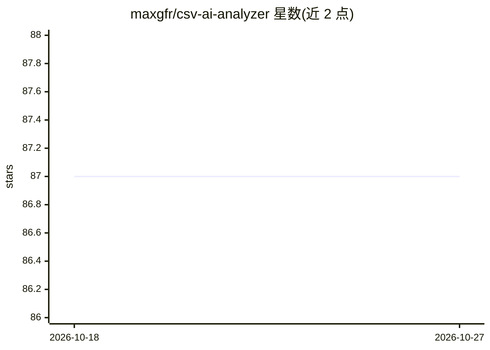

# maxgfr/csv-ai-analyzer

⭐ 87 · TypeScript · MIT · 推送 2026-10-20 · [GitHub](https://github.com/maxgfr/csv-ai-analyzer) · [官网](https://maxgfr.github.io/csv-ai-analyzer) · 个人维护

**自托管浏览器端 AI CSV/Excel 分析应用：多 LLM 生成洞察与图表**

基于 Next.js 的浏览器端 CSV/Excel 分析应用：拖拽上传后自动检测分隔符、推断列类型，支持交互表格浏览；AI 部分接入 OpenAI、Anthropic、Google、Mistral 等多个 API 提供商，也支持自定义 OpenAI 兼容端点（Ollama、LM Studio、vLLM）实现本地处理。AI 可生成数据摘要、异常检测、自然语言问答与 5 类图表建议，API key 在浏览器内 AES-GCM 加密存储。提供 Docker 自托管与 npm 库 csv-charts-ai 两种形态；导入、质量检查在 Web Worker 中运行，测试场景至 10 万行。

## 筛选速览

| 维度 | 判定 | 备注 |
|---|---|---|
| AI 角色 | `ai-native` | 本体是模型或模型工具 |
| 许可风险 | `permissive` | MIT |
| 部署形态 | `self-host` | docker 或自建部署 |
| 模型依赖 | local-ok | 支持本地模型 |
| 硬件要求 | — | 无带数字的原话,不猜 |
| 安装摩擦 | `low` | 无编译、无系统依赖或容器化 |
| 成熟度 | — | 结构信号不足 |

## 能力要点

- 多 AI 提供商接入与自定义 OpenAI 兼容端点（Ollama/LM Studio/vLLM）
- AI 生成摘要、异常检测、自然语言问答与图表建议（Bar/Line/Pie/Scatter/Area）
- API key 浏览器内 AES-GCM 加密存储，不存储数据、无追踪
- 核心能力另发布为独立 npm 包 csv-charts-ai，可在 React/Node/CLI 中使用

## 适用场景

- 上传 CSV/Excel 文件让 AI 生成分析洞察和可视化图表
- 通过自定义端点连接本地 LLM，数据不出本地
- 在自有基础设施上用 Docker 自托管数据分析工具

## 场景标签

`数据分析` · 领域:效率与自动化

## 证据(README 行号)

> L16: A modern, elegant application to analyze your CSV and Excel (.xlsx) files with Artificial Intelligence using multip
> L32: - **Multiple AI providers**: OpenAI, Anthropic Claude, Google Gemini, Mistral, and more

## 星数曲线

2026-10-18 87 → 2026-10-27 87（+0）

---
*卡片 v1 · prompt 1.4 · 生成 2026-10-23 · 置信度 high · 依据 README sha `09dee9abe84d` · [字段定义](../../DATASET.md)*
