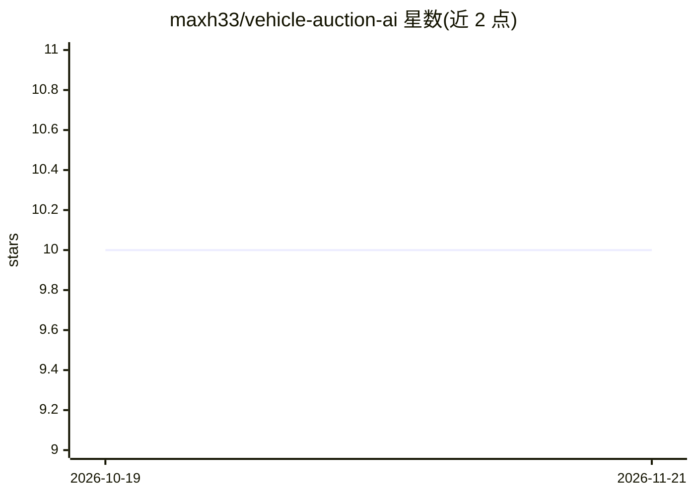

# maxh33/vehicle-auction-ai

⭐ 10 · Python · MIT · 推送 2026-08-30 · [GitHub](https://github.com/maxh33/vehicle-auction-ai) · 个人维护

**巴西事故车拍卖批次的 AI 辅助评估框架，支持出价决策**

面向巴西拍卖市场（Copart Brazil、Sodré Santoro 等）的受损/事故回收车辆评估框架：Copart 批次通过 copart_scraper.py 自动抓取结构化数据并下载高清照片，其他拍卖行采用手动采集流程；配套按车型组织的 SQLite 拆车件价格库（来源 OLX 等，含导入与导出脚本），用户提供模板化 prompt 与照片，在 Claude Code 会话中生成技术分析与成本分析报告，输出建议最高出价。附车型专检指南（如 Prius 混动电池检查）、已分析批次记录与巴西法律背景说明。仅 MIT 许可的开源脚本集合，自动采集依赖自建 Crawl4AI 服务。

## 筛选速览

| 维度 | 判定 | 备注 |
|---|---|---|
| AI 角色 | `ai-enhanced` | 去掉 AI 部分产品仍成立 |
| 许可风险 | `permissive` | MIT |
| 部署形态 | `library` | 以包/库形式分发 |
| 模型依赖 | — | README 未给出锁定关系 |
| 硬件要求 | — | 无带数字的原话,不猜 |
| 安装摩擦 | `low` | 无编译、无系统依赖或容器化 |
| 成熟度 | — | 结构信号不足 |

## 能力要点

- Copart 批次自动抓取：结构化字段提取 + HD 照片（1600×1200）下载
- SQLite 拆车件价格库，支持 OLX 数据导入与碰撞/水淹件清单导出
- 模板化评估 prompt，配合 Claude Code 生成技术分析与成本分析
- 包含 Toyota Prius Gen 4 等车型的专项预购检查指南

## 适用场景

- 参与 Copart 巴西事故车拍卖前评估车辆损伤与成本
- 对比拆车件价格与维修成本，计算合理出价上限
- 为特定车型建立预购检查清单与知识库

## 场景标签

`网页抓取` · 领域:效率与自动化

## 证据(README 行号)

> L7: Framework de análise de lotes em leilões de veículos com apoio de IA (Claude/Gemini).
> L115: ### 5. Rodar a análise com IA
> L117: No Claude Code, abrir uma nova sessão neste projeto e submeter:

## 星数曲线

2026-10-19 10 → 2026-11-21 10（+0）

---
*卡片 v1 · prompt 1.4 · 生成 2026-11-19 · 置信度 high · 依据 README sha `a3f545d94722` · [字段定义](../../DATASET.md)*
