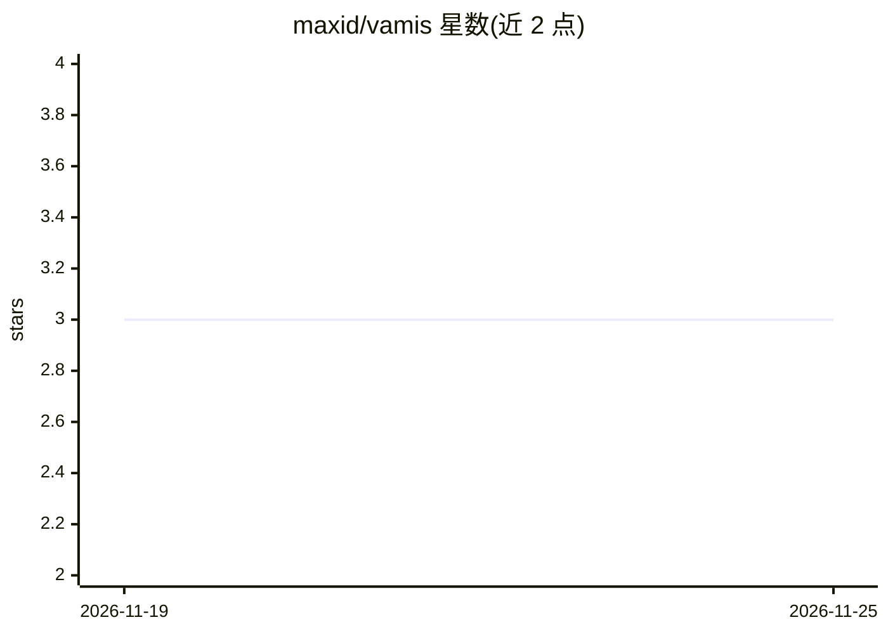

# maxid/vamis

⭐ 3 · TypeScript · NOASSERTION · 推送 2026-11-23 · [GitHub](https://github.com/maxid/vamis) · [官网](https://maxid.github.io/vamis/) · 个人维护 · 中文 README

**Vue 3 低代码运行时，用 YAML/JSON 配置生成页面**

用 Vue 3 + shadcn-vue 重新实现的 Amis 兼容低代码运行时：同一份 Amis schema 可在 Vue 中渲染，无需 React。作者态支持 YAML 与 JSON（parseSchemaText 自动识别），信封对齐 LCDP IR；提供 Vue VamisRoot 与任意 HTML 的 vamis.embed 两条嵌入入口，并附带可视化编辑器（组件树/画布/属性面板）。需 Node 20+ 与 pnpm 从源码运行，npm 包尚在准备中；README 自述为早期 alpha，不建议用于关键生产。

## 筛选速览

| 维度 | 判定 | 备注 |
|---|---|---|
| AI 角色 | `ai-enhanced` | 去掉 AI 部分产品仍成立 |
| 许可风险 | `none` | NOASSERTION |
| 部署形态 | `library` | 以包/库形式分发 |
| 模型依赖 | — | README 未给出锁定关系 |
| 硬件要求 | — | 无带数字的原话,不猜 |
| 安装摩擦 | `low` | 无编译、无系统依赖或容器化 |
| 成熟度 | `idea` | |

## 能力要点

- Amis schema 兼容：185/189 个 type 名称已注册
- YAML 与 JSON 平权，支持裸 widget 与 IR 信封输入
- 两条嵌入入口：Vue VamisRoot 与 HTML vamis.embed
- 附带可视化编辑器与 Playwright 逐结点对照测试（1203 项测试）

## 适用场景

- 在 Vue 3 项目中直接渲染已有的 Amis schema 页面
- 用 YAML 配置生成表单、CRUD 等后台页面
- 通过可视化编辑器搭建页面并导出 YAML/JSON

## 场景标签

 · 领域:前端开发/低代码

## 证据(README 行号)

> L5: Vamis 是用 Vue 3 + shadcn-vue 重实现的 **Amis 兼容** JSON/YAML 低代码运行时：同一份 Amis schema，不再套 React。作者态支持 **YAML** 与 **JSON**，信封
> L48: 当前从源码运行（npm 包发布准备中）。需要 Node 20+ 与 pnpm。

## 星数曲线

2026-11-19 3 → 2026-11-25 3（+0）

---
*卡片 v1 · prompt 1.4 · 生成 2026-11-21 · 置信度 mid · 依据 README sha `c2b056ca630d` · [字段定义](../../DATASET.md)*
