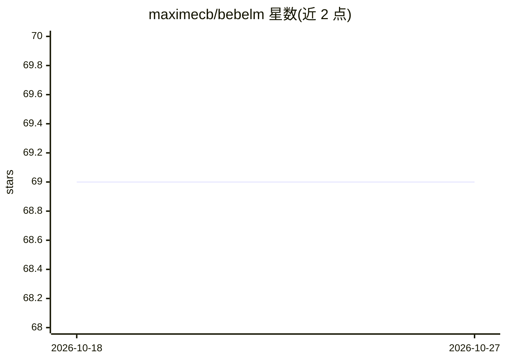

# maximecb/bebelm

⭐ 69 · Rust · MIT · 推送 2026-06-16 · [GitHub](https://github.com/maximecb/bebelm) · 个人维护

**纯 Rust CPU 推理库：本地运行 LFM2.5-8B-A1B 模型**

以 Rust 库 crate 优先、附带薄 CLI 的形式实现 LiquidAI LFM2.5-8B-A1B（Q4_K_M 量化）的 CPU-only 推理。CLI 提供 generate/chat/ask 子命令，支持流式输出、思考块控制与采样参数调节。库层以 Agent 为入口，支持多轮会话、KV/conv 缓存持久化、前缀 prefill 与 clone 分叉、工具调用循环，tokenizer 与 sampler 亦公开可直用。运行需约 6-8GB RAM 并下载 5.2GB GGUF 权重；x86 SIMD 内核按构建机器调优，可用 RUSTFLAGS 覆盖生成可移植二进制。

## 筛选速览

| 维度 | 判定 | 备注 |
|---|---|---|
| AI 角色 | `ai-native` | 本体是模型或模型工具 |
| 许可风险 | `permissive` | MIT |
| 部署形态 | `library` | 以包/库形式分发 |
| 模型依赖 | — | README 未给出锁定关系 |
| 硬件要求 | `cpu-ok` | |
| 安装摩擦 | `medium` | 含编译或系统依赖之一 |
| 成熟度 | — | 结构信号不足 |

## 能力要点

- 纯 Rust、CPU-only 实现 LFM2.5-8B-A1B Q4_K_M 推理
- Agent 库 API：多轮会话、prefill 预热、Clone 分叉、工具调用循环
- CLI 提供 generate/chat/ask，支持流式输出与思考块（<think>）控制
- 依赖极少，无需额外系统包即可编译

## 适用场景

- 在无 GPU 的机器上本地运行 LFM2.5-8B-A1B 模型
- 在 Rust 项目中嵌入本地 LLM 会话与函数调用能力
- 预热共享前缀后低成本分叉多个独立对话续写

## 场景标签

`推理引擎` · 领域:训练与推理

## 证据(README 行号)

> L3: Pure-Rust, CPU-only implementation of LFM2.5-8B-A1B Q4_K_M.
> L66: - **`generate [options] <prompt>…`** — one-shot text completion of a prompt; streams tokens as
> L94: `bebelm` is a library first; the CLI is a thin wrapper over it. The high-level entry point is

## 星数曲线

2026-10-18 69 → 2026-10-27 69（+0）

---
*卡片 v1 · prompt 1.4 · 生成 2026-10-24 · 置信度 high · 依据 README sha `cb510dcaa7a2` · [字段定义](../../DATASET.md)*
