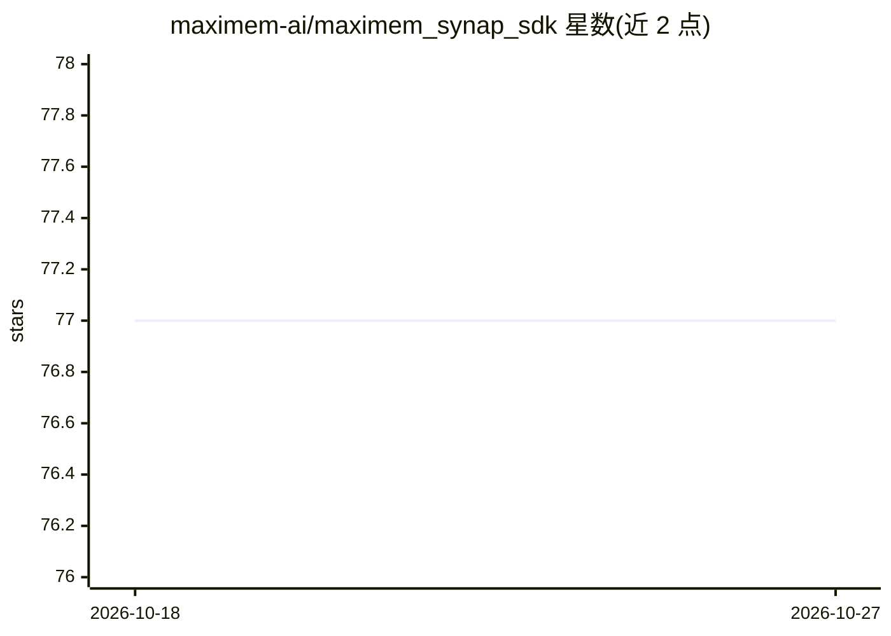

# maximem-ai/maximem_synap_sdk

⭐ 77 · Python · Apache-2.0 · 推送 2026-10-26 · [GitHub](https://github.com/maximem-ai/maximem_synap_sdk) · [官网](https://www.maximem.ai/synap) · 组织维护

**为生产 AI agent 提供跨会话持久记忆的 SDK 与托管服务**

Synap 是面向生产级 AI agent 的记忆层：开源 Python/JS SDK、24 个框架集成包（LangChain、CrewAI、LlamaIndex、AutoGen 等）及 MCP 服务器（Apache 2.0），记忆引擎（摄取、实体消解、检索、预取）运行在托管的 Synap Cloud，本地无服务器可跑，使用需 API key（含免费档）。机制含预取式检索（内部测量 ~15ms P50）、时间衰减、撤销处理、四层多租户作用域；发布 LongMemEval 92.0%、LoCoMo 93.2% 基准及开源评测工具（含 Mem0/Zep/Supermemory 适配器）。要求 Python 3.11+ 或 Node 20+。

## 筛选速览

| 维度 | 判定 | 备注 |
|---|---|---|
| AI 角色 | `ai-ecosystem` | LLM/agent 周边工具 |
| 许可风险 | `permissive` | Apache-2.0 |
| 部署形态 | `library` | 以包/库形式分发 |
| 模型依赖 | — | README 未给出锁定关系 |
| 硬件要求 | — | 无带数字的原话,不猜 |
| 安装摩擦 | `low` | 无编译、无系统依赖或容器化 |
| 成熟度 | — | 结构信号不足 |

## 能力要点

- 24 个框架集成包（LangChain/LlamaIndex/CrewAI/AutoGen/LiveKit 等）
- 预取式检索：agent 请求前准备好上下文
- 四层作用域（client/customer/user/conversation）单次 fetch 合并
- MCP 服务器将记忆暴露为 4 个工具，供无代码/低代码 agent 使用

## 适用场景

- 让我的 agent 在跨会话、跨设备间记住用户信息
- 为语音 AI agent 提供低延迟上下文预取
- B2B 多租户场景下按公司/用户隔离记忆

## 场景标签

`Agent 记忆` · 领域:Agent 开发

## 证据(README 行号)

> L20: Synap gives your agents memory that lasts across conversations, sessions and devices. It scores **92.0% on LongMemE
> L28: |Python + JS SDKs, 24 framework packages, MCP adapter|✅ open source|uses them|
> L83: The SDK connects to the hosted Synap cloud service, so you'll need an API key. There's no local server to run: memo

## 星数曲线

2026-10-18 77 → 2026-10-27 77（+0）

---
*卡片 v1 · prompt 1.4 · 生成 2026-10-24 · 置信度 high · 依据 README sha `6d54ba28d224` · [字段定义](../../DATASET.md)*
