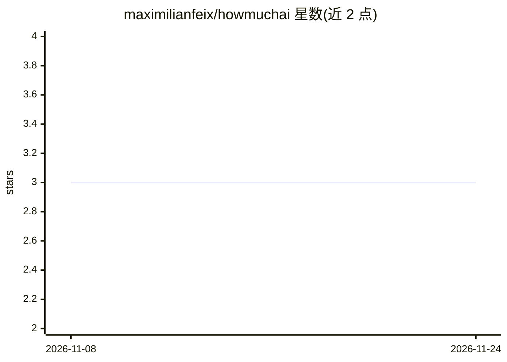

# maximilianfeix/howmuchai

⭐ 3 · TypeScript · MIT · 推送 2026-11-24 · [GitHub](https://github.com/maximilianfeix/howmuchai) · [官网](https://maximilianfeix.github.io/howmuchai/) · 个人维护 · 中文 README

**统计公开仓库提交与 PR 中 AI 编码代理签名的工具**

howmuchai 读取公开 GitHub 仓库最近 90 天的提交与 PR，统计携带 AI 编码代理签名（Co-authored-by、机器人作者、footer 等）的比例，并列出逐条证据；维护 top-1000 仓库排行榜与 README 徽章/卡片。使用方式包括浏览器页面（直接调 GitHub API）、npx CLI、GitHub Action 与 MCP server。方法上只统计已披露签名，作者明确说明结果是下界，不做 AI 检测器猜测。

## 筛选速览

| 维度 | 判定 | 备注 |
|---|---|---|
| AI 角色 | `ai-ecosystem` | LLM/agent 周边工具 |
| 许可风险 | `permissive` | MIT |
| 部署形态 | `library` | 以包/库形式分发 |
| 模型依赖 | — | README 未给出锁定关系 |
| 硬件要求 | — | 无带数字的原话,不猜 |
| 安装摩擦 | `low` | 无编译、无系统依赖或容器化 |
| 成熟度 | — | 结构信号不足 |

## 能力要点

- 浏览器查询、npx CLI、GitHub Action、MCP server 四种使用方式
- 签名注册表 signatures/agents.json 以正则形式列出各代理识别规则
- 实验性 likely 区间：基于作者披露率、代理配置文件与提交风格逻辑回归模型
- 每个匹配链接到对应 commit 作为证据

## 适用场景

- 查看某个公开仓库最近提交中 AI 代理参与的比例
- 给自己的仓库生成 AI 签名占比徽章
- 通过 Claude/Cursor 等 MCP 客户端直接查询仓库的代理签名数据

## 场景标签

 · 领域:开发者工具/仓库分析

## 证据(README 行号)

> L9:  Paste any public GitHub repo. howmuchai reads its recent commits and pull requests and counts the ones that carry a
> L95: howmuchai is also an MCP server, so Claude, Cursor, VS Code and other clients can ask it directly. It has four read
> L129: howmuchai does not guess and does not run an AI detector. It counts what is **disclosed**:

## 星数曲线

2026-11-08 3 → 2026-11-24 3（+0）

---
*卡片 v1 · prompt 1.4 · 生成 2026-11-21 · 置信度 high · 依据 README sha `e6f3d0684fa4` · [字段定义](../../DATASET.md)*
