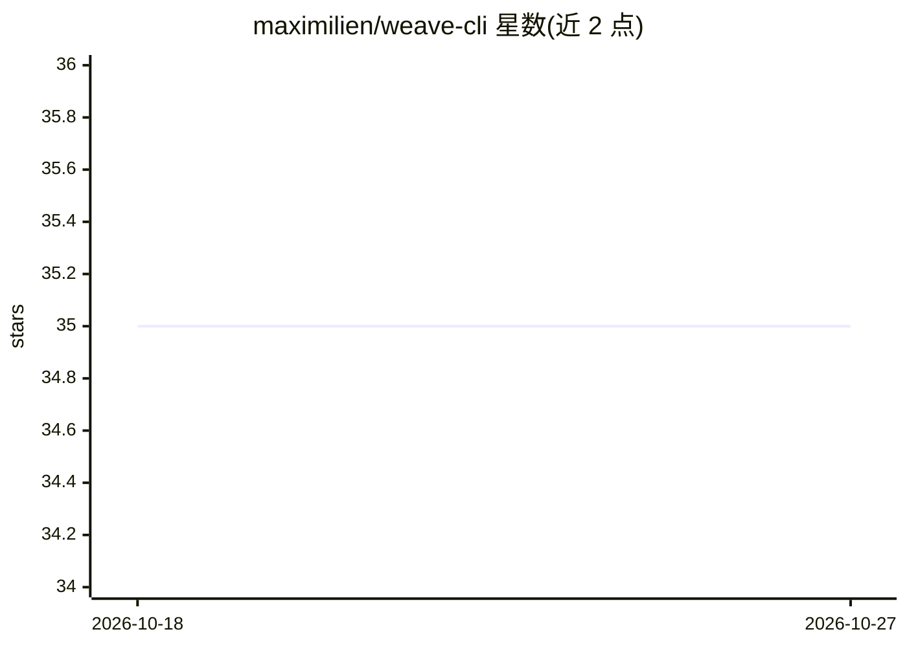

# maximilien/weave-cli

⭐ 35 · Go · MIT · 推送 2026-10-26 · [GitHub](https://github.com/maximilien/weave-cli) · [官网](https://github.com/maximilien/weave-cli) · 个人维护

**管理多种向量数据库的通用 CLI：查看/建删/搜索集合与文档**

用 Go 编写的单二进制命令行工具，面向开发、测试与调试场景，通过统一抽象层管理 11 种向量数据库（Weaviate、Qdrant、Milvus、Chroma、Supabase、Neo4j、MongoDB、Redis、Pinecone、OpenSearch、Elasticsearch）的集合与文档。支持三种嵌入提供方（OpenAI、sentence-transformers、Ollama），提供 AI Agent REPL 模式（GPT-4o 多代理）、语义搜索、PDF 摄取、并行批处理、备份恢复（.weavebak，可上传 S3/MinIO）、大图外部存储与 Prometheus 监控。各 VDB 后端分 Stable/Beta/Experimental 状态。

## 筛选速览

| 维度 | 判定 | 备注 |
|---|---|---|
| AI 角色 | `ai-ecosystem` | LLM/agent 周边工具 |
| 许可风险 | `permissive` | MIT |
| 部署形态 | `self-host` | docker 或自建部署 |
| 模型依赖 | local-ok | 支持本地模型 |
| 硬件要求 | — | 无带数字的原话,不猜 |
| 安装摩擦 | `low` | 无编译、无系统依赖或容器化 |
| 成熟度 | — | 结构信号不足 |

## 能力要点

- 统一 CLI 管理 11 种向量数据库的集合与文档
- AI Agent REPL 模式：自然语言查询、schema 与分块建议
- 备份恢复为 .weavebak 便携文件，支持 S3/MinIO 远程存储与跨 VDB 迁移
- 三种嵌入提供方（OpenAI/sentence-transformers/Ollama），含免费本地方案

## 适用场景

- 开发调试时快速查看、创建、删除多个向量数据库的集合
- 在不同向量数据库之间做备份与数据迁移
- 批量摄取 PDF 并执行语义搜索，由 AI 建议 schema 与分块策略

## 场景标签

`向量数据库` `语义搜索` · 领域:知识与检索

## 证据(README 行号)

> L3: A fast, AI-powered command-line (CLI) tool for managing your vector database (VDBs).
> L256: - 🔌 **Extensible** - Vector database abstraction layer supporting multiple
> L266: - 📊 **Embeddings** - Multiple providers (OpenAI, sentence-transformers, Ollama)

## 星数曲线

2026-10-18 35 → 2026-10-27 35（+0）

---
*卡片 v1 · prompt 1.4 · 生成 2026-10-25 · 置信度 mid · 依据 README sha `578368deccac` · [字段定义](../../DATASET.md)*
