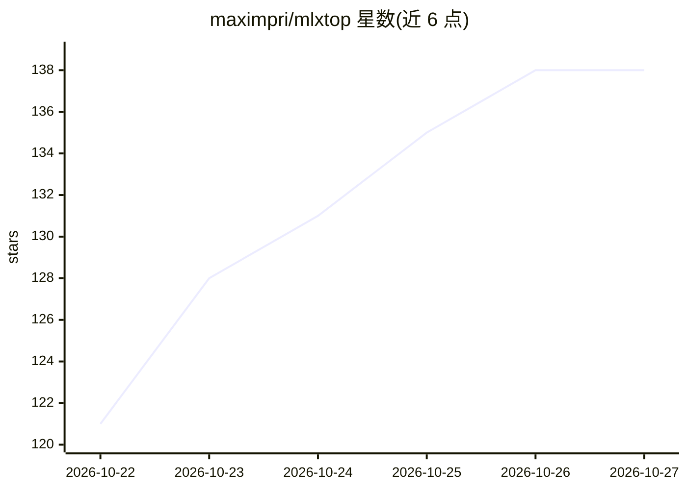

# maximpri/mlxtop

⭐ 138 · Rust · MIT · 推送 2026-10-22 · [GitHub](https://github.com/maximpri/mlxtop) · 个人维护

**本地 LLM 推理的 TUI 资源监控工具：内存/分页/GPU/吞吐同屏**

用 Rust 编写的终端仪表盘（top 类工具），面向在本地运行 LLM 的用户：把系统侧读数（内存压力、压缩、分页、GPU、降频）与 13 种推理运行时自报的指标（tokens/s、prefill 进度、队列、缓存复用）并排显示，并给出一行健康判定。支持 oMLX、Splash、vLLM、llama.cpp、Ollama 等运行时，自动检测；本地只读、无遥测。限制：一次只监控一个服务器，GPU 活动为全系统粒度，不能证明变慢根因。macOS 需 11+ 且仅 Apple Silicon。

## 筛选速览

| 维度 | 判定 | 备注 |
|---|---|---|
| AI 角色 | `ai-ecosystem` | LLM/agent 周边工具 |
| 许可风险 | `permissive` | MIT |
| 部署形态 | `desktop` | 安装包/桌面程序 |
| 模型依赖 | local-ok | 支持本地模型 |
| 硬件要求 | — | 无带数字的原话,不猜 |
| 安装摩擦 | `low` | 无编译、无系统依赖或容器化 |
| 成熟度 | — | 结构信号不足 |

## 能力要点

- 系统资源读数与 13 种运行时自报推理指标并排显示
- 一行式健康判定（如重度分页、模型部分在 CPU、显卡满载、过热降频）
- 支持 oMLX/Splash/mlx-serve/vLLM/SGLang/llama.cpp/Ollama 等 13 种运行时自动检测
- 本地只读、无 sudo、无账号、无遥测，不读取提示词

## 适用场景

- 本地模型变慢时排查是内存、分页还是 GPU 瓶颈
- 终端/SSH 下用 --once 输出一次性文本报告
- 实时观察 tokens/s 与 prefill 进度、队列和缓存复用

## 场景标签

`LLM 可观测性` · 领域:评测与运维

## 证据(README 行号)

> L3: **`top` for local LLMs.** See whether memory, paging or the GPU is what's slowing your model down.
> L28: - **13 runtimes:** oMLX, Splash, mlx-serve, vLLM, SGLang, llama.cpp, Ollama,

## 星数曲线

2026-10-22 121 → 2026-10-27 138（+17）

---
*卡片 v1 · prompt 1.4 · 生成 2026-10-23 · 置信度 high · 依据 README sha `d86550a33bf7` · [字段定义](../../DATASET.md)*
