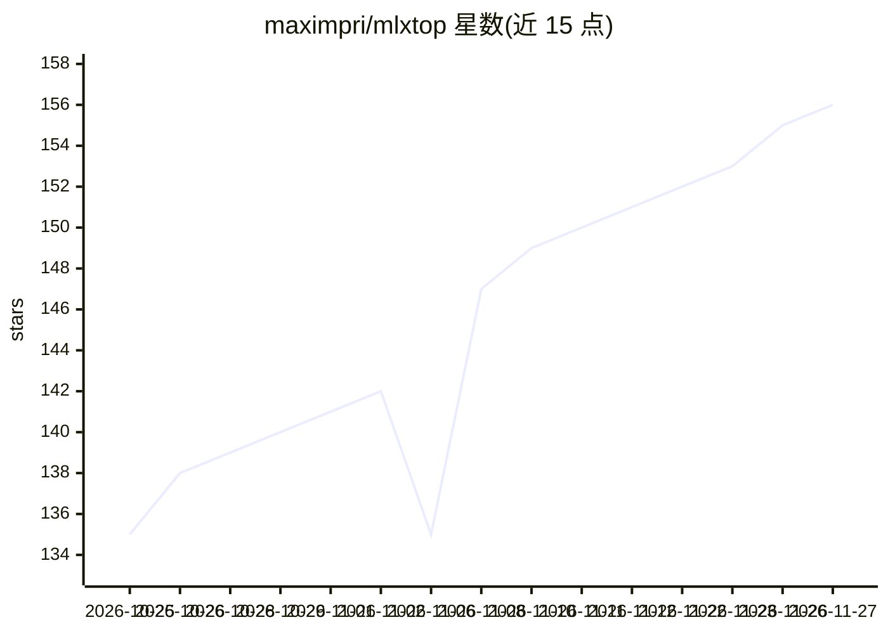

# maximpri/mlxtop

⭐ 156 · Rust · MIT · 推送 2026-11-26 · [GitHub](https://github.com/maximpri/mlxtop) · 个人维护

**本地 LLM 运行时的 top 式终端监控工具**

用 Rust 编写的终端 TUI 监控工具，面向本地运行 LLM 的用户：读取系统内存压力、压缩、分页与 GPU 状态，并结合运行时自身上报的 tokens/s、prefill 进度、队列与缓存数据，输出单行健康判定（如分页严重、GPU 满载、热节流）。自动检测 15 种运行时，支持 TUI 面板、--once 文本报告、JSON 流与 Prometheus /metrics（仅回环）。本地只读，无需 sudo、不上传数据。macOS（Apple Silicon）、Linux、Windows 提供 Homebrew/脚本/安装包，Linux 为静态二进制。

## 筛选速览

| 维度 | 判定 | 备注 |
|---|---|---|
| AI 角色 | `ai-ecosystem` | LLM/agent 周边工具 |
| 许可风险 | `permissive` | MIT |
| 部署形态 | `desktop` | 安装包/桌面程序 |
| 模型依赖 | local-ok | 支持本地模型 |
| 硬件要求 | — | 无带数字的原话,不猜 |
| 安装摩擦 | `low` | 无编译、无系统依赖或容器化 |
| 成熟度 | — | 结构信号不足 |

## 能力要点

- 自动检测 15 种本地运行时（oMLX、vLLM、llama.cpp、Ollama、LM Studio 等）并读取各自指标
- 单行健康判定：命名分页、CPU 卸载、GPU 满载、热节流等问题
- 带宽估算：对比芯片标称内存带宽判断 decode 是否接近极限
- 提供 stream JSON、Prometheus metrics 与 --once SSH 可用模式

## 适用场景

- 本地模型变慢时排查是内存、分页还是 GPU 的问题
- 为多台本地推理服务器采集 Prometheus 指标做仪表盘
- 脚本中用 JSON 流记录推理会话的资源数据

## 场景标签

 · 领域:LLM 基础设施/监控

## 证据(README 行号)

> L3: **`top` for local LLMs.** See whether memory, paging or the GPU is what's slowing your model down.
> L28: - **15 runtimes:** oMLX, Splash, mlx-serve, vLLM, SGLang, llama.cpp,

## 星数曲线

2026-10-25 135 → 2026-11-27 156（+21）

---
*卡片 v1 · prompt 1.4 · 生成 2026-11-27 · 置信度 high · 依据 README sha `d81c9fb137fc` · [字段定义](../../DATASET.md)*
