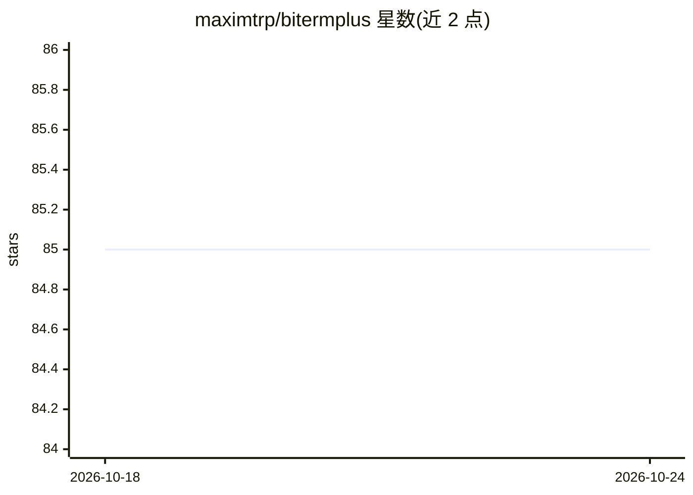

# maximtrp/bitermplus

⭐ 85 · Python · MIT · 推送 2026-08-27 · [GitHub](https://github.com/maximtrp/bitermplus) · [官网](https://bitermplus.readthedocs.io) · 个人维护

**短文本主题建模的 Biterm 主题模型 Python 库**

Bitermplus 是 Biterm Topic Model（BTM，短文本主题建模）的 Python 实现，核心算法经 Cython 化并使用 NumPy 向量化。提供 scikit-learn 兼容 API（fit/transform/fit_transform）与传统多步 API，支持 sklearn 流水线、交叉验证与网格搜索；内置困惑度、语义一致性、熵等评估指标，支持多种推断方法（biterm 之和、词之和、混合）。依赖 Python ≥3.9 及 NumPy/Pandas/SciPy/scikit-learn/tqdm，经 PyPI 安装；Linux 上需 Python 开发头文件。可用 tmplot 做交互式可视化。

## 筛选速览

| 维度 | 判定 | 备注 |
|---|---|---|
| AI 角色 | `ai-native` | 本体是模型或模型工具 |
| 许可风险 | `permissive` | MIT |
| 部署形态 | `library` | 以包/库形式分发 |
| 模型依赖 | — | README 未给出锁定关系 |
| 硬件要求 | — | 无带数字的原话,不猜 |
| 安装摩擦 | `low` | 无编译、无系统依赖或容器化 |
| 成熟度 | — | 结构信号不足 |

## 能力要点

- BTM 算法的 Cython 化实现，面向短文本主题建模
- scikit-learn 兼容 API，支持流水线、交叉验证与网格搜索
- 内置困惑度、语义一致性、熵等模型评估指标
- 多种推断方法（sum of biterms / sum of words / mixed）

## 适用场景

- 对推文、搜索查询等短文本做主题建模
- 在 sklearn 流水线中做主题建模与超参数调优
- 提取主题关键词与文档-主题分布

## 场景标签

 · 领域:NLP/机器学习库

## 证据(README 行号)

> L10: **Bitermplus** is a high-performance implementation of the Biterm Topic Model for short text analysis, originally d
> L14: - **Scikit-learn Compatible API** — Familiar `fit()`, `transform()`, and `fit_transform()` methods for easy adoptio

## 星数曲线

2026-10-18 85 → 2026-10-24 85（+0）

---
*卡片 v1 · prompt 1.4 · 生成 2026-10-24 · 置信度 high · 依据 README sha `bc900e3571dd` · [字段定义](../../DATASET.md)*
