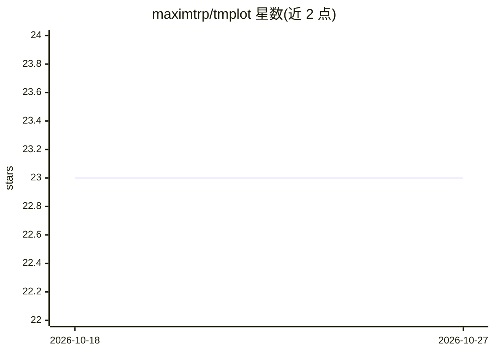

# maximtrp/tmplot

⭐ 23 · Python · MIT · 推送 2026-08-31 · [GitHub](https://github.com/maximtrp/tmplot) · [官网](https://tmplot.readthedocs.org) · 个人维护

**主题模型分析与可视化 Python 库，供数据科学家使用**

tmplot 是一个 Python 包，用于主题模型的分析、可视化与比较：生成交互式主题散点图、词项概率图与文档分析报告，支持 tomotopy、gensim、bitermplus 三类库产出的模型。分析功能包括跨多次运行的主题稳定性分析、模型比较（KL/JSD/Hellinger 等多种距离度量）、词项显著性与熵计算，降维支持 t-SNE、MDS、Isomap 等方法。通过 pip 从 PyPI 安装，核心依赖为 numpy/scipy/scikit-learn/pandas/altair/ipywidgets，主题模型库为可选依赖。

## 筛选速览

| 维度 | 判定 | 备注 |
|---|---|---|
| AI 角色 | `ai-ecosystem` | LLM/agent 周边工具 |
| 许可风险 | `permissive` | MIT |
| 部署形态 | `library` | 以包/库形式分发 |
| 模型依赖 | — | README 未给出锁定关系 |
| 硬件要求 | — | 无带数字的原话,不猜 |
| 安装摩擦 | `low` | 无编译、无系统依赖或容器化 |
| 成熟度 | — | 结构信号不足 |

## 能力要点

- 交互式主题散点图、词项概率图与实时调参报告
- 支持 tomotopy/gensim/bitermplus 三类库的多种模型
- 6 种距离度量的主题距离矩阵与模型比较
- 跨多次运行的主题稳定性分析与熵、显著性计算

## 适用场景

- 我想交互式浏览和调参主题模型的结果
- 我想比较多份训练出的主题模型并找出稳定主题
- 我想用不同距离度量和降维方法可视化主题结构

## 场景标签

 · 领域:数据科学/主题建模

## 证据(README 行号)

> L11: **tmplot** is a comprehensive Python package for **topic modeling analysis and visualization**. Built for data scie
> L35: - **tomotopy**: `LDAModel`, `LLDAModel`, `CTModel`, `DMRModel`, `HDPModel`, `PTModel`, `SLDAModel`, `GDMRModel`

## 星数曲线

2026-10-18 23 → 2026-10-27 23（+0）

---
*卡片 v1 · prompt 1.4 · 生成 2026-10-27 · 置信度 high · 依据 README sha `92a014625264` · [字段定义](../../DATASET.md)*
