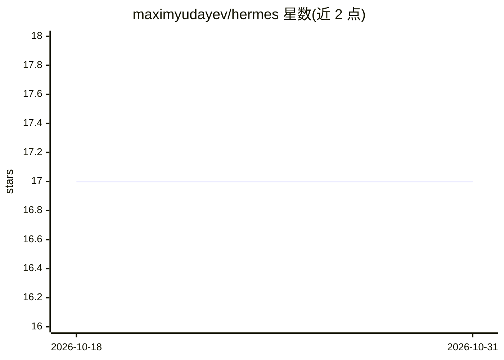

# maximyudayev/hermes

⭐ 17 · Python · MIT · 推送 2026-10-28 · [GitHub](https://github.com/maximyudayev/hermes) · [官网](http://yudayev.com/hermes/) · 组织维护

**分布式多模态生理信号实时采集与边缘 AI 处理框架**

面向闭环智能医疗应用的统一开源框架：在本地网络中跨多台分布式主机同步、连续采集异构多模态数据（相机、IMU、sEMG、MoCap 等商业传感器），数据以 MKV/MP4 与 HDF5 落盘；提供 PyTorch 模型封装用于实时边缘 AI 流处理。以 pip 可装的 Python 包形式分发（python>=3.7），各传感器支持以独立子包安装，部分子包需 OEM 软件；视频/音频场景需另装 FFmpeg。系统通过 YAML 配置文件组织各主机的 Producer/Consumer/Pipeline，另配套 PyQt6 标注看板 PysioViz 与基准测试代码。

## 筛选速览

| 维度 | 判定 | 备注 |
|---|---|---|
| AI 角色 | `ai-ecosystem` | LLM/agent 周边工具 |
| 许可风险 | `permissive` | MIT |
| 部署形态 | `library` | 以包/库形式分发 |
| 模型依赖 | — | README 未给出锁定关系 |
| 硬件要求 | — | 无带数字的原话,不猜 |
| 安装摩擦 | `medium` | 含编译或系统依赖之一 |
| 成熟度 | — | 结构信号不足 |

## 能力要点

- 跨分布式主机同步连续采集异构多模态数据
- 10+ 商业传感器设备的流式集成子包，含自定义设备扩展模板
- PyTorch 模型封装子包支持实时边缘 AI 流处理
- YAML 配置组织 Producer/Consumer/Pipeline，数据落盘为 MKV/MP4 与 HDF5

## 适用场景

- 可穿戴/康复外骨骼实验中多设备生理与运动数据同步采集
- 在边缘设备上对多模态数据流做实时 AI 推理以触发闭环干预
- 为 AI 训练工作流生成带时间同步标注的多模态数据集

## 场景标签

 · 领域:医疗健康/传感与边缘计算

## 证据(README 行号)

> L24: HERMES offers out-of-the-box streaming integrations to a number of commercial sensor devices and systems, high reso
> L43: Will install the AI processing subpackage to wrap user-specified PyTorch models.

## 星数曲线

2026-10-18 17 → 2026-10-31 17（+0）

---
*卡片 v1 · prompt 1.4 · 生成 2026-10-29 · 置信度 high · 依据 README sha `a8ac79acf32e` · [字段定义](../../DATASET.md)*
