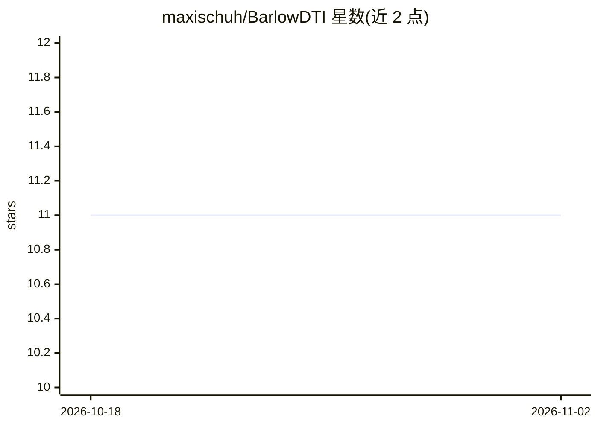

# maxischuh/BarlowDTI

⭐ 11 · Python · GPL-3.0 · 推送 2025-12-09 · [GitHub](https://github.com/maxischuh/BarlowDTI) · [官网](https://huggingface.co/spaces/mschuh/BarlowDTI) · 组织维护

**基于 Barlow Twins 的药物-靶点相互作用预测模型**

药物发现领域的深度学习方法：利用 Barlow Twins 架构对一维输入（药物与靶蛋白序列信息）进行特征提取，结合深度学习与梯度提升机作为预测器，预测药物-靶点相互作用；不依赖大量计算资源。模型提供影响力分析方法，用于考察个体训练样本对决策的影响，并与共晶结构比对验证。代码与数据存于本仓库，并提供可免费访问的 Web 界面。面向药物发现研究者，附引用文献。

## 筛选速览

| 维度 | 判定 | 备注 |
|---|---|---|
| AI 角色 | `ai-native` | 本体是模型或模型工具 |
| 许可风险 | `viral` | GPL-3.0 |
| 部署形态 | `None` |  |
| 模型依赖 | — | README 未给出锁定关系 |
| 硬件要求 | — | 无带数字的原话,不猜 |
| 安装摩擦 | `low` | 无编译、无系统依赖或容器化 |
| 成熟度 | — | 结构信号不足 |

## 能力要点

- Barlow Twins 架构用于一维输入特征提取
- 深度学习 + 梯度提升机混合预测器
- 影响力方法用于考察个体训练样本对决策的作用
- 提供可免费访问的 Web 界面

## 适用场景

- 预测候选药物与靶点蛋白的相互作用
- 理解模型依据哪些训练样本做出决策
- 药物发现流程中筛选潜在靶点结合分子

## 场景标签

`科研工具` · 领域:学习与行业

## 证据(README 行号)

> L6: ## Barlow Twins deep neural network for advanced 1D drug–target interaction prediction
> L8: Accurate prediction of drug–target interactions is critical for advancing drug discovery. By reducing time and cost,

## 星数曲线

2026-10-18 11 → 2026-11-02 11（+0）

---
*卡片 v1 · prompt 1.4 · 生成 2026-11-02 · 置信度 high · 依据 README sha `b38f9cea454d` · [字段定义](../../DATASET.md)*
