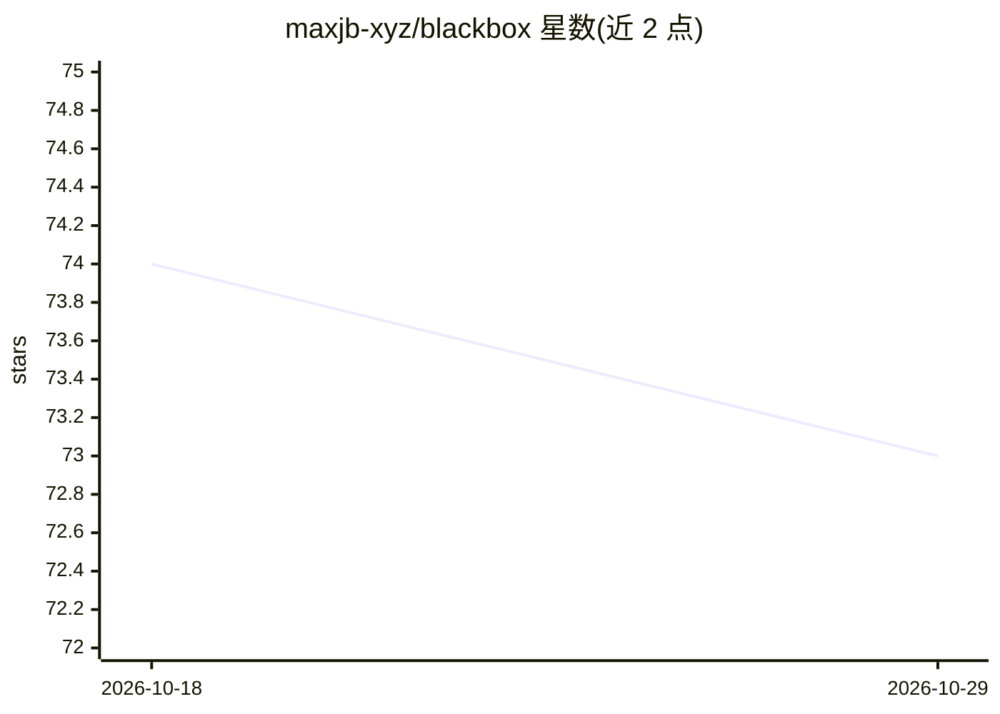

# maxjb-xyz/blackbox

⭐ 73 · Go · AGPL-3.0 · 推送 2026-08-09 · [GitHub](https://github.com/maxjb-xyz/blackbox) · [官网](https://blackboxd.dev) · 个人维护

**面向家庭实验室的自托管事件时间线与故障取证平台**

Go 编写的自托管事件关联平台：从 Docker 事件、配置文件变更、systemd 单元、Uptime Kuma/Watchtower/Komodo webhook 采集事件，汇聚成统一时间线，并将疑似宕机分组为 incident，附带加权根因候选评分；可选配置 Ollama 或其他 AI 提供方做事件分析或 AI 增强关联，并能生成事后 PDF 报告。以 Docker 镜像部署（amd64/arm64，非 root），支持多节点 agent、OIDC 登录与可选 MCP Server 向 AI 助手暴露数据。自述为 beta 软件，且声明大量代码由生成式 AI 辅助编写。

## 筛选速览

| 维度 | 判定 | 备注 |
|---|---|---|
| AI 角色 | `ai-enhanced` | 去掉 AI 部分产品仍成立 |
| 许可风险 | `viral` | AGPL-3.0 |
| 部署形态 | `self-host` | docker 或自建部署 |
| 模型依赖 | local-ok | 支持本地模型 |
| 硬件要求 | — | 无带数字的原话,不猜 |
| 安装摩擦 | `low` | 无编译、无系统依赖或容器化 |
| 成熟度 | `idea` | |

## 能力要点

- 聚合 Docker/文件/systemd/webhook 事件为单一时间线并关联为 incident
- 加权根因候选评分与日志片段证据链
- 可选 Ollama AI 分析、AI 增强关联与事后 PDF 报告
- 内置 MCP Server（list_incidents/search_entries 等 5 个工具）向 AI 助手暴露数据

## 适用场景

- 家庭服务器宕机时快速看到发生了什么、何时、为何
- 把容器更新、配置改动与监控告警放进同一时间线排查
- 让 AI 助手通过 MCP 查询我的事件与 incident 数据

## 场景标签

 · 领域:基础设施可观测性/自托管运维

## 证据(README 行号)

> L12: Blackbox is a lightweight, self-hosted event correlation platform built for homelabbers who want to understand thei
> L77: - **Optional AI modes** - If Ollama or other AI provider is configured, Blackbox can run either plain AI analysis o
> L101: ### MCP Server (optional)

## 星数曲线

2026-10-18 74 → 2026-10-29 73（-1）

---
*卡片 v1 · prompt 1.4 · 生成 2026-10-24 · 置信度 high · 依据 README sha `860ee1aedd53` · [字段定义](../../DATASET.md)*
