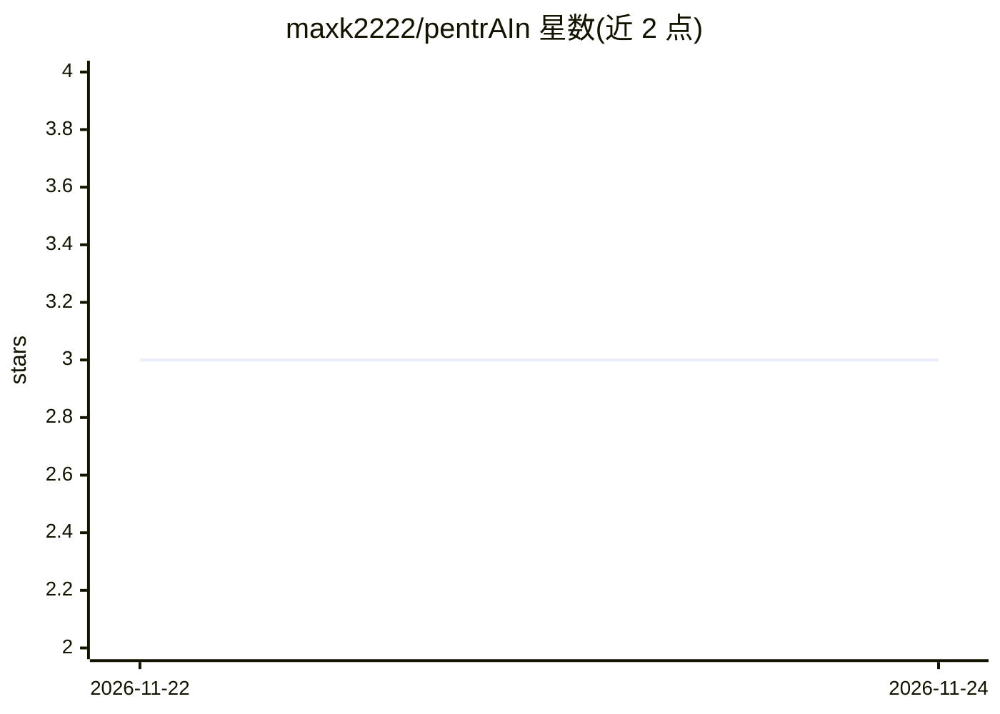

# maxk2222/pentrAIn

⭐ 3 · Python · NOASSERTION · 推送 2026-11-21 · [GitHub](https://github.com/maxk2222/pentrAIn) · 个人维护

**自托管渗透测试训练平台：CTF 任务+AI 教练+浏览器 Kali**

把一台 Proxmox 主机变成引导式进攻性安全训练场：57/88 个任务按 13 条轨道组织（Linux、Web appsec、AD、取证、无线等），选择任务后自动部署隔离靶场（路由器、靶机、流式传输到浏览器的真实 Kali 桌面）。AI 教练监视用户命令遥测并以流式 Markdown 回答，提供 Observer→Mentor→Copilot→Autonomous 四档自主级别，最高档可在可见 tmux 中驱动 Kali。动态 flag 由 HMAC 按会话派生并经 QEMU guest agent 注入。需要 Proxmox VE 主机与 Ansible ≥2.15，提供 nested/direct 两种安装模式；AD 轨道声明尚未在实机验证，Kali worker 目前仅 CPU。

## 筛选速览

| 维度 | 判定 | 备注 |
|---|---|---|
| AI 角色 | `ai-enhanced` | 去掉 AI 部分产品仍成立 |
| 许可风险 | `none` | NOASSERTION |
| 部署形态 | `None` |  |
| 模型依赖 | — | README 未给出锁定关系 |
| 硬件要求 | `cpu-ok` | |
| 安装摩擦 | `low` | 无编译、无系统依赖或容器化 |
| 成熟度 | `idea` | |

## 能力要点

- 13 条轨道的任务库，含分级提示扣分与排行榜计分
- 四档自主级别 AI 教练，最高档可驱动 Kali 并行 worker agent
- 每任务附带 defense.md，覆盖利用检测与修复
- 动态 flag 按会话 HMAC 派生，重置即重新随机化

## 适用场景

- 在家用 Proxmox 上自建渗透测试 CTF 练习环境
- 按轨道循序渐进学习 Linux/Web/AD 渗透技能
- 需要 AI 教练提示或代操作的自主攻防训练

## 场景标签

`网络安全` `教程课程` `编码 Agent` · 领域:编码与开发

## 证据(README 行号)

> L19: pentrAIn turns a Proxmox host into a guided offensive-security range. Pick a
> L53:  🤖 AI coach
> L126: Ludus is consumed as an **external range engine**

## 星数曲线

2026-11-22 3 → 2026-11-24 3（+0）

---
*卡片 v1 · prompt 1.4 · 生成 2026-11-22 · 置信度 high · 依据 README sha `017bf8f9a6bb` · [字段定义](../../DATASET.md)*
