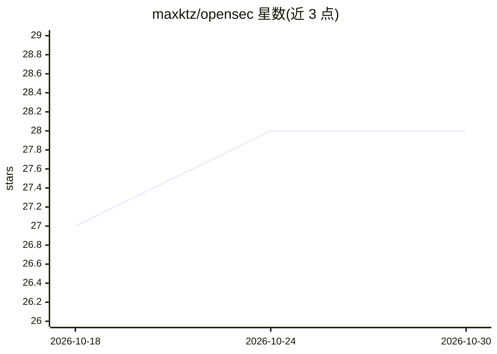

# maxktz/opensec

⭐ 28 · TypeScript · 推送 2026-05-15 · [GitHub](https://github.com/maxktz/opensec) · [官网](https://opensec.sh) · 个人维护

**开源仓库安全审查捐赠匹配平台（MVP）**

面向开源维护者与捐赠者的安全审查对接 Web 应用：维护者可为公开 GitHub 仓库申请私有报告，捐赠者用自己的 AI 算力或安全工具执行审查并提交 Markdown 报告；公开页面仅展示仓库元数据与汇总统计，报告全文仅申请者与捐赠者可见。技术栈为 Next.js + Better Auth（仅 GitHub OAuth）+ PostgreSQL/Drizzle ORM，以 Bun + Turborepo 管理工作区，从源码运行。项目自述为 MVP。

## 筛选速览

| 维度 | 判定 | 备注 |
|---|---|---|
| AI 角色 | `ai-enhanced` | 去掉 AI 部分产品仍成立 |
| 许可风险 | `none` | — |
| 部署形态 | `None` |  |
| 模型依赖 | — | README 未给出锁定关系 |
| 硬件要求 | — | 无带数字的原话,不猜 |
| 安装摩擦 | `low` | 无编译、无系统依赖或容器化 |
| 成熟度 | `idea` | |

## 能力要点

- 维护者申请仓库安全审查、捐赠者提交 Markdown 报告的对接流程
- 报告内容私有，公开页面仅展示元数据与汇总统计
- Next.js + Better Auth(GitHub OAuth) + Drizzle ORM + Bun/Turborepo 技术栈

## 适用场景

- 开源维护者为公开仓库申请安全审查报告
- 有闲置 AI 算力或安全工具的用户捐赠安全审查
- 查看开源仓库的安全审查状态汇总

## 场景标签

`网络安全` · 领域:学习与行业

## 证据(README 行号)

> L3: OpenSec is an MVP for donated security reviews of public open source GitHub repositories.
> L5: Maintainers can request a private report for a public repository. Donors can use their own AI capacity or security t

## 星数曲线

2026-10-18 27 → 2026-10-30 28（+1）

---
*卡片 v1 · prompt 1.4 · 生成 2026-10-26 · 置信度 mid · 依据 README sha `f00f4354b4f9` · [字段定义](../../DATASET.md)*
