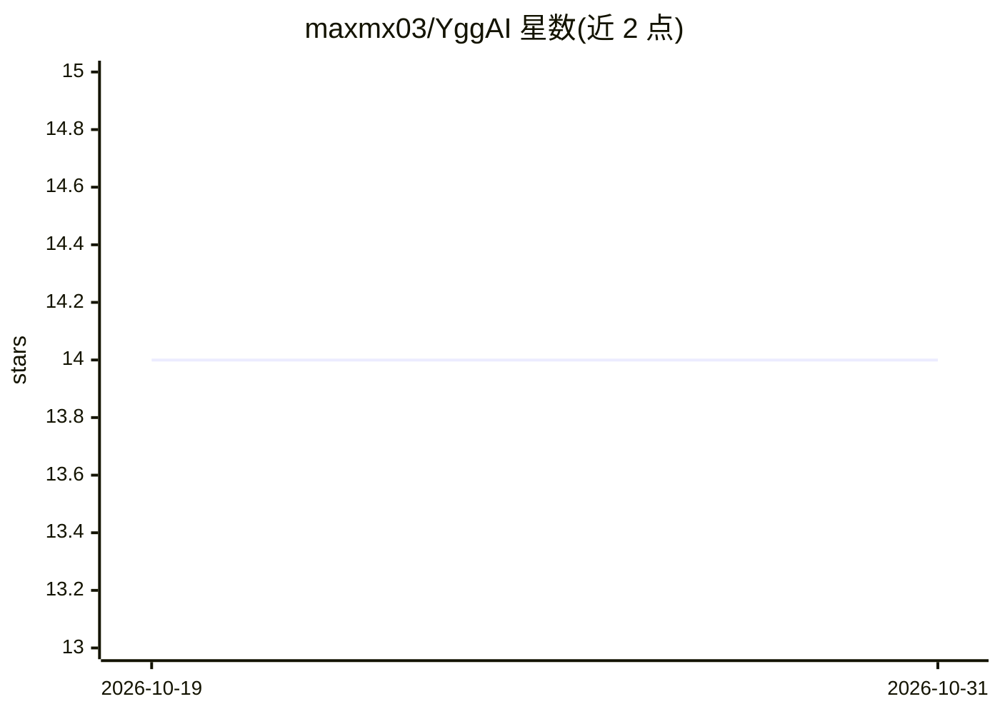

# maxmx03/YggAI

⭐ 14 · Lua · GPL-3.0 · 推送 2026-04-24 · [GitHub](https://github.com/maxmx03/YggAI) · [官网](https://browiki.org/wiki/Homunculus#AI) · 个人维护

**仙境传说Online游戏内AI：用行为树自动操控生命体**

用 Lua 编写的《仙境传说Online》AI 脚本项目，通过游戏自带的 USER_AI 机制控制玩家生命体自动战斗。决策逻辑采用行为树组织，为 Eira、Dieter、Eleanor、Sera、Bayeri 五种生命体分别定义了技能优先级、连招顺序与针对怪物属性的技能选择策略。安装方式为下载 ZIP 或 git clone 到游戏 AI 目录，游戏内输入 /hoai 启用，通过编辑 config.lua 配置生命体等级等参数。

## 筛选速览

| 维度 | 判定 | 备注 |
|---|---|---|
| AI 角色 | `ai-native` | 本体是模型或模型工具 |
| 许可风险 | `viral` | GPL-3.0 |
| 部署形态 | `None` |  |
| 模型依赖 | — | README 未给出锁定关系 |
| 硬件要求 | — | 无带数字的原话,不猜 |
| 安装摩擦 | `low` | 无编译、无系统依赖或容器化 |
| 成熟度 | — | 结构信号不足 |

## 能力要点

- 基于行为树的分层决策逻辑
- 覆盖 Eira/Dieter/Eleanor/Sera/Bayeri 五种生命体的技能策略
- 按怪物属性（水/火/毒等）与 MVP 选择技能
- config.lua 配置生命体等级等参数

## 适用场景

- 让我的生命体在游戏中自动战斗与施放技能
- 针对不同怪物属性和 MVP 战自动选择技能策略

## 场景标签

 · 领域:游戏/自动化脚本

## 证据(README 行号)

> L8: Este é um projeto de AI para o jogo Ragnarok Online, desenvolvido em Lua.
> L12: A inteligência artificial deste projeto é construída utilizando Behavior Trees. Essa abordagem organiza a lógica de

## 星数曲线

2026-10-19 14 → 2026-10-31 14（+0）

---
*卡片 v1 · prompt 1.4 · 生成 2026-10-31 · 置信度 high · 依据 README sha `f88075eff3f9` · [字段定义](../../DATASET.md)*
