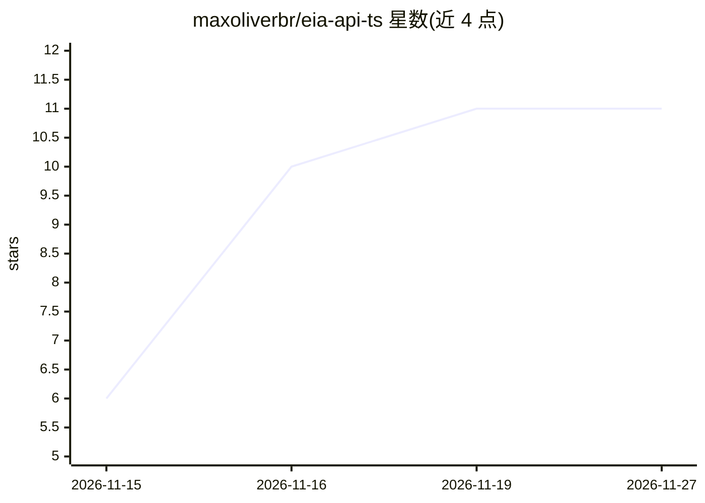

# maxoliverbr/eia-api-ts

⭐ 11 · TypeScript · MIT · 推送 2026-11-23 · [GitHub](https://github.com/maxoliverbr/eia-api-ts) · [官网](https://maxoliverbr.github.io/eia-api-ts/) · 个人维护

**为 AI agent 封装美国 EIA 能源 APIv2 的本地服务**

本地运行的 HTTP 服务，将美国能源信息署（EIA）APIv2 的 100+ 端点、15 个数据域封装为统一的查询接口：提供 /domains、/search 等自描述发现端点、机器可读的 agent 指南、RDF 风格能源本体知识图谱，并可通过环境变量开启 MCP 服务（9 个工具 + 2 个资源）。内置响应缓存、出站请求限速与错误规范化，EIA API key 保留在服务端。基于 Bun 与 ElysiaJS 构建，端到端类型化，服务本身不依赖 LLM。

## 筛选速览

| 维度 | 判定 | 备注 |
|---|---|---|
| AI 角色 | `ai-ecosystem` | LLM/agent 周边工具 |
| 许可风险 | `permissive` | MIT |
| 部署形态 | `None` |  |
| 模型依赖 | — | README 未给出锁定关系 |
| 硬件要求 | — | 无带数字的原话,不猜 |
| 安装摩擦 | `low` | 无编译、无系统依赖或容器化 |
| 成熟度 | — | 结构信号不足 |

## 能力要点

- 统一 POST /query 端点访问全部 15 个 EIA 数据域
- /guide 提供机器可读 agent 指南（工作流、决策树、反模式）
- /ontology 提供 RDF 风格能源本体知识图谱与 JSON-LD/Turtle 导出
- MCP 服务以 9 工具 + 2 资源接入 Claude Desktop、Cursor 等 MCP 客户端

## 适用场景

- 让 LLM agent 动态发现并查询美国能源数据
- 在 Cursor/Claude Desktop 中通过 MCP 查询电力、煤炭、天然气数据
- 构建 TypeScript 能源分析应用并复用类型化客户端

## 场景标签

`知识图谱` `数据分析` · 领域:效率与自动化

## 证据(README 行号)

> L8: The U.S. Energy Information Administration (EIA) exposes a rich but sprawling REST API — 100+ endpoints across 15 da
> L26: - **MCP server at `/mcp`** — the same surface, exposed as 9 tools + 2 resources for any Model Context Protocol clie
> L158: The same surface, exposed as a Model Context Protocol endpoint at `/mcp` for any MCP-compatible client (Claude Des

## 星数曲线

2026-11-15 6 → 2026-11-27 11（+5）

---
*卡片 v1 · prompt 1.4 · 生成 2026-11-19 · 置信度 high · 依据 README sha `cc6aa0397c6f` · [字段定义](../../DATASET.md)*
