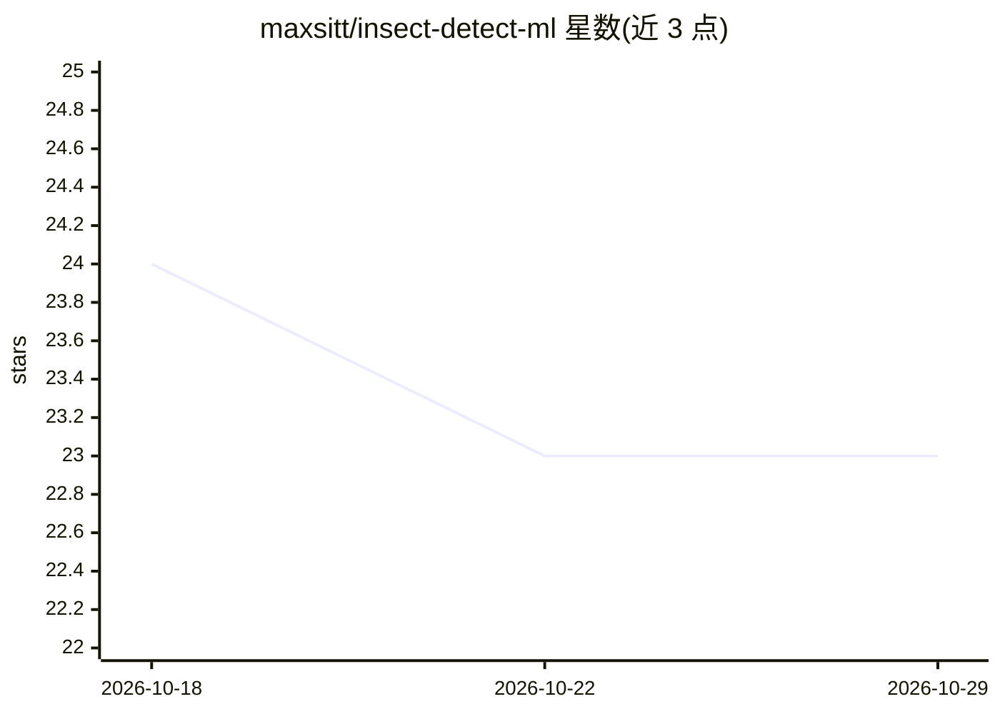

# maxsitt/insect-detect-ml

⭐ 23 · Jupyter Notebook · AGPL-3.0 · 推送 2026-08-07 · [GitHub](https://github.com/maxsitt/insect-detect-ml) · [官网](https://maxsitt.github.io/insect-detect-docs/) · 个人维护

**昆虫检测/分类模型训练 notebook 与数据处理脚本**

围绕 Insect Detect DIY 相机陷阱的机器学习工具库：提供可在 Google Colab（免费云 GPU）上运行的 Jupyter notebook，训练自定义 YOLOv5/6/7/8 目标检测模型与 YOLOv5 图像分类模型；分类模型基于 EfficientNet-B0、27 类昆虫数据集，测试集 Top1 准确率 0.972，支持导出 ONNX。另含分类脚本（自定义 yolov5 fork）、元数据后处理与图像清理脚本。注意：README 顶部声明本方法已被 insect-detect-post 取代、不再维护，检测训练部分也在重构中。

## 筛选速览

| 维度 | 判定 | 备注 |
|---|---|---|
| AI 角色 | `ai-native` | 本体是模型或模型工具 |
| 许可风险 | `viral` | AGPL-3.0 |
| 部署形态 | `desktop` | 安装包/桌面程序 |
| 模型依赖 | — | README 未给出锁定关系 |
| 硬件要求 | — | 无带数字的原话,不猜 |
| 安装摩擦 | `low` | 无编译、无系统依赖或容器化 |
| 成熟度 | — | 结构信号不足 |

## 能力要点

- Google Colab notebook 训练 YOLOv5/6/7/8 检测与 YOLOv5 分类模型
- EfficientNet-B0 分类模型（27 类，测试 Top1 0.972），支持 ONNX 导出
- 分类脚本支持按 top1 类/概率排序图片并合并元数据 CSV
- 元数据后处理与损坏图像清理脚本

## 适用场景

- 为昆虫监测相机陷阱训练目标检测模型
- 对捕获的昆虫图像做分类并整理元数据
- 复现论文中的分类模型与数据集划分

## 场景标签

`目标检测` `模型训练` · 领域:感知与多模态

## 证据(README 行号)

> L12: This repository contains Jupyter notebooks that can be used to train custom
> L15: object detection models or a custom YOLOv5 image classification
> L79: |EfficientNet-B0|128|0.972|0.971|0.967|0.969|

## 星数曲线

2026-10-18 24 → 2026-10-29 23（-1）

---
*卡片 v1 · prompt 1.4 · 生成 2026-10-27 · 置信度 mid · 依据 README sha `01f11af30af6` · [字段定义](../../DATASET.md)*
