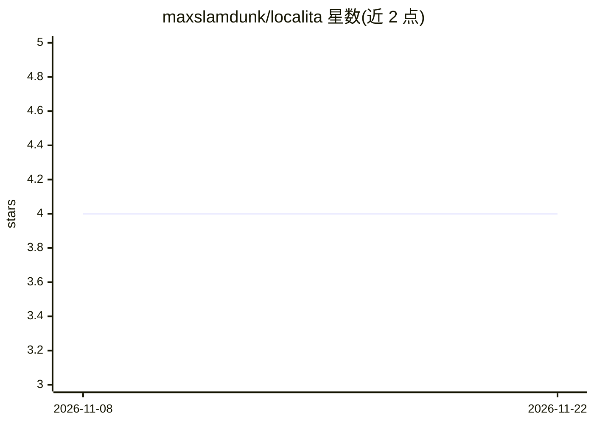

# maxslamdunk/localita

⭐ 4 · Swift · Apache-2.0 · 推送 2026-11-12 · [GitHub](https://github.com/maxslamdunk/localita) · 个人维护

**在 iPhone 上离线运行 Gemma 4 26B-A4B 的聊天应用**

面向 iPhone 用户的完全离线聊天应用：在手机本地运行 Google Gemma 4 26B-A4B 混合专家模型，输入与照片不离开设备。引擎以 Swift 和 Metal 编写，含自有 GPU kernel，不依赖 MLX 或 llama.cpp；采用专家流式读取、专家缓存、预读与专家跳过等机制把约 14.3 GB 模型装进手机内存。支持图像输入包、多模型构建安装、内置基准测试。通过 TestFlight 公测提供，也可用 Xcode 自行构建；仅 iPhone 17（8 GB）经测试。

## 筛选速览

| 维度 | 判定 | 备注 |
|---|---|---|
| AI 角色 | `ai-native` | 本体是模型或模型工具 |
| 许可风险 | `permissive` | Apache-2.0 |
| 部署形态 | `None` |  |
| 模型依赖 | — | README 未给出锁定关系 |
| 硬件要求 | — | 无带数字的原话,不猜 |
| 安装摩擦 | `low` | 无编译、无系统依赖或容器化 |
| 成熟度 | `idea` | |

## 能力要点

- 在手机本地运行 26B 参数 MoE 模型，每 token 仅激活约 3.9B 参数
- 专家流式读取＋专家缓存＋早期预读＋专家跳过等内存机制
- 可选约 1.1 GB 图像包支持读取所附照片
- 内置基准测试，结果可一键上报并发布在仓库中

## 适用场景

- 无网络环境下在 iPhone 上与 26B 模型对话
- 在手机本地让模型解读照片，数据不出设备
- 为不同 iPhone 机型采集推理速度基准数据

## 场景标签

`聊天机器人` · 领域:对话与助手

## 证据(README 行号)

> L30: Localita is an offline chat app for iPhone built around Google's
> L48: - **Chat with Gemma 4.** Your conversations stay on the phone. Replies render
> L110: The runtime is written for this one model in Swift and Metal, with its own GPU

## 星数曲线

2026-11-08 4 → 2026-11-22 4（+0）

---
*卡片 v1 · prompt 1.4 · 生成 2026-11-21 · 置信度 high · 依据 README sha `b92bd0377320` · [字段定义](../../DATASET.md)*
