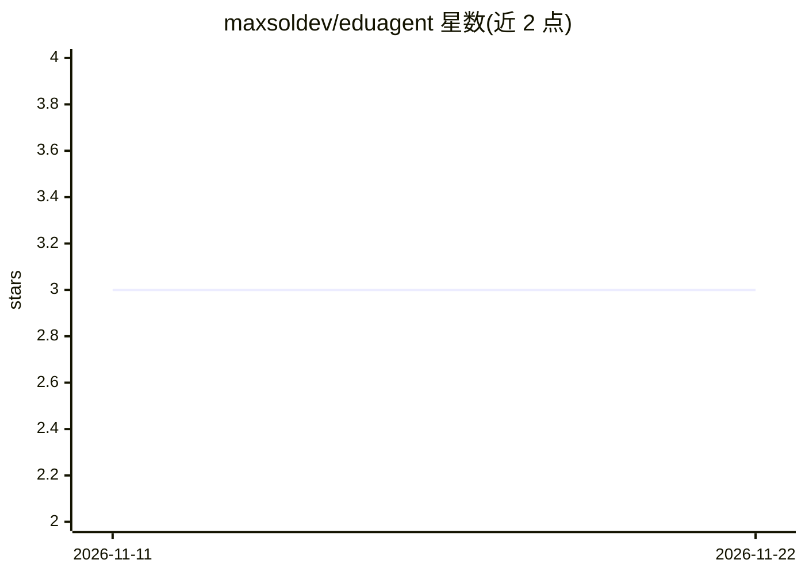

# maxsoldev/eduagent

⭐ — · [GitHub]() · 个人维护

**面向开发者的 coding-agent 工作原理教学：可读复现+可视化**

以教学为目的重新实现真实 coding-agent 框架：educodex（Python 复现 OpenAI Codex）与 edupi（TypeScript 复现 pi），保留原框架的线协议、提示词与沙箱设计，去掉规模化部分，并通过一个 web 可视化界面展示提示组装、模型请求、工具调用、审批策略等每一步。启动器为每个浏览器标签页起一个后端进程，也可加载真实 pi 做对比。运行需要 Node 22.19+、pnpm、uv 与 OpenRouter API key，另有假模型服务器可无 key 运行。

## 筛选速览

| 维度 | 判定 | 备注 |
|---|---|---|
| AI 角色 | `ai-ecosystem` | LLM/agent 周边工具 |
| 许可风险 | `none` | — |
| 部署形态 | `library` | 以包/库形式分发 |
| 模型依赖 | locked-api |  |
| 硬件要求 | — | 无带数字的原话,不猜 |
| 安装摩擦 | `low` | 无编译、无系统依赖或容器化 |
| 成熟度 | — | 结构信号不足 |

## 能力要点

- educodex 复现 Codex 的线协议、系统提示词、apply_patch 工具与 Seatbelt 沙箱
- web UI 含 Timeline/Context/Requests/Guardrails 等面板展示 agent 每个隐藏步骤
- step mode 可在每个模型请求与工具调用前暂停
- 保留 Codex 原 Apache-2.0 vendored 文件并提供再同步脚本

## 适用场景

- 学习 coding-agent 内部机制：提示组装、审批策略、沙箱执行
- 对比教学复现版与真实 pi 框架的行为差异
- 查看 agent 每次模型调用的原始请求体与上下文构成

## 场景标签

`教程课程` · 领域:学习与行业

## 证据(README 行号)

> L3: Readable re-implementations of real coding-agent harnesses, with one web UI (the visualiser) that shows every hidden
> L43: Production coding agents hide most of what they do: how the prompt is assembled, the exact request sent to the mode

## 星数曲线

2026-11-11 3 → 2026-11-22 3（+0）

---
*卡片 v1 · prompt 1.4 · 生成 2026-11-21 · 置信度 mid · 依据 README sha `4540449c3838` · [字段定义](../../DATASET.md)*
