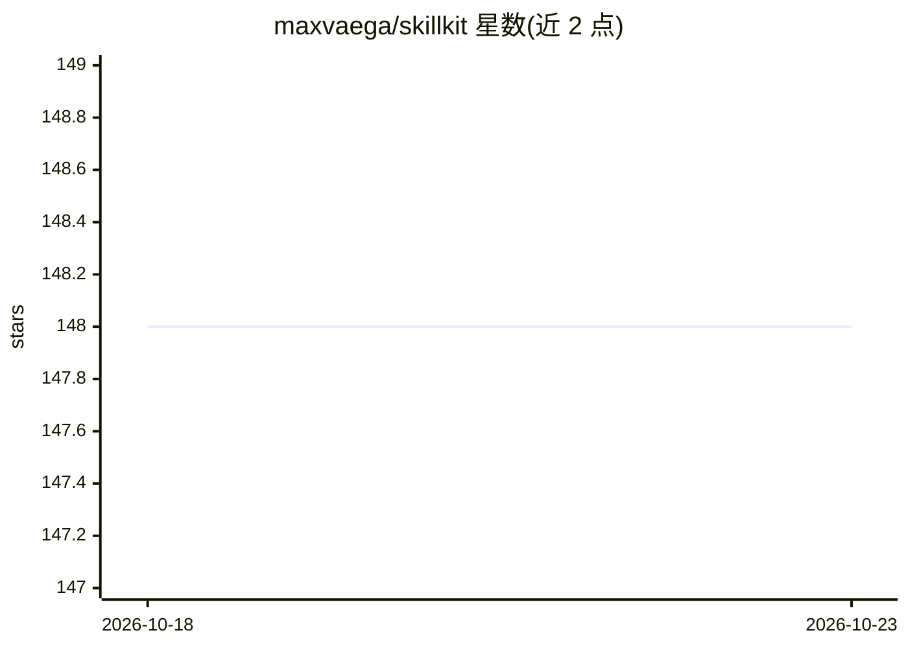

# maxvaega/skillkit

⭐ 148 · Python · MIT · 推送 2026-01-23 · [GitHub](https://github.com/maxvaega/skillkit) · 个人维护

**为 Python agent 提供 Anthropic Agent Skills 功能的技能库**

让任意 Python agent 获得 Anthropic Agent Skills 能力的框架：读取与 Anthropic 兼容的 SKILL.md 格式技能包（YAML frontmatter + 可选脚本），支持多来源发现（项目目录、Anthropic 配置、MCPB 插件、自定义路径）与优先级冲突解决。采用渐进式披露加载（元数据优先、内容 LRU 缓存），可执行技能内捆绑的 Python/Shell/JS/Ruby/Perl 脚本并带安全控制。可脱离框架独立使用，当前提供 LangChain 集成（同步与异步），模型无关。

## 筛选速览

| 维度 | 判定 | 备注 |
|---|---|---|
| AI 角色 | `ai-ecosystem` | LLM/agent 周边工具 |
| 许可风险 | `permissive` | MIT |
| 部署形态 | `library` | 以包/库形式分发 |
| 模型依赖 | — | README 未给出锁定关系 |
| 硬件要求 | — | 无带数字的原话,不猜 |
| 安装摩擦 | `low` | 无编译、无系统依赖或容器化 |
| 成熟度 | — | 结构信号不足 |

## 能力要点

- 兼容现有 SKILL.md 技能，可直接复用网络上的技能仓库
- 渐进式披露加载与内容缓存（README 称 80% 内存降低）
- 技能内脚本执行（Python/Shell/JS/Ruby/Perl）附安全控制与沙箱措施
- 多来源技能发现与 MCPB 插件清单支持

## 适用场景

- 让自建 Python agent 使用现成的 Claude 技能包
- 在 LangChain agent 中以工具形式调用技能与脚本
- 将组织内流程知识打包为可复用的技能供 agent 调用

## 场景标签

`Agent 框架` · 领域:Agent 开发

## 证据(README 行号)

> L3:  Enables Anthropic's Agent Skills functionality to any python agent, unleashing LLM-powered agents to autonomously d
> L20: - **Framework-free**: can be used without any framework, or with other frameworks (currently only compatible with L
> L21: - **Model-agnostic**: Works with any LLM

## 星数曲线

2026-10-18 148 → 2026-10-23 148（+0）

---
*卡片 v1 · prompt 1.4 · 生成 2026-10-22 · 置信度 high · 依据 README sha `bec70bb17100` · [字段定义](../../DATASET.md)*
