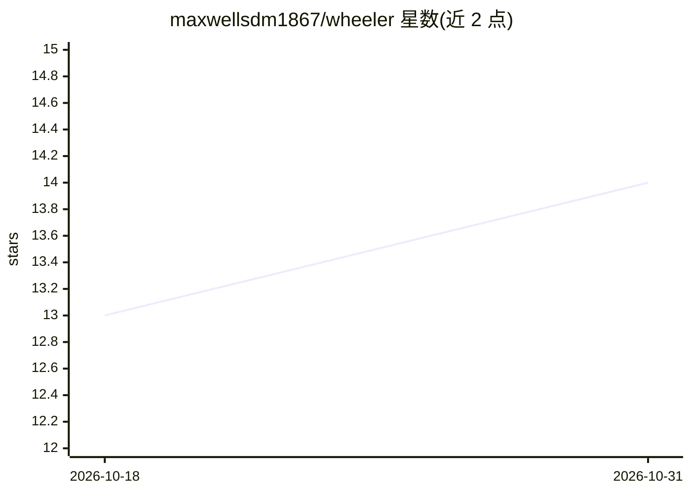

# maxwellsdm1867/wheeler

⭐ 14 · Python · MIT · 推送 2026-09-22 · [GitHub](https://github.com/maxwellsdm1867/wheeler) · 个人维护

**面向科学家的 Claude Code/Codex 研究工作流插件：知识图谱+溯源**

以插件形式运行于 Claude Code 与 OpenAI Codex 的科研工作流系统：提供 40 个研究动作（discuss/plan/execute/write 等）与四个 MCP 服务器，两宿主共享同一套动作与溯源规则。核心机制是基于 Neo4j 的本地知识图谱：单次工具调用在记录发现的同时生成完整 W3C PROV-DM 溯源链；脚本或数据变更时标记下游发现为过期并下调稳定性分数。无需单独的模型 API key，图谱与项目工件均在本地运行。前提依赖：Python 3.11+、uv、Neo4j（Desktop 或 Aura）。当前状态 Beta。

## 筛选速览

| 维度 | 判定 | 备注 |
|---|---|---|
| AI 角色 | `ai-ecosystem` | LLM/agent 周边工具 |
| 许可风险 | `permissive` | MIT |
| 部署形态 | `library` | 以包/库形式分发 |
| 模型依赖 | — | README 未给出锁定关系 |
| 硬件要求 | — | 无带数字的原话,不猜 |
| 安装摩擦 | `low` | 无编译、无系统依赖或容器化 |
| 成熟度 | `idea` | |

## 能力要点

- 40 个研究动作 + 4 个 MCP 服务器打包为单一插件，Claude Code 与 Codex 双宿主
- 单次工具调用生成发现及完整 W3C PROV-DM 溯源链
- 脚本/数据变更时自动标记下游发现过期并下调稳定性分数
- plan 阶段预注册图表，execute 后生成对照 visual brief 报告

## 适用场景

- 在 Claude Code 或 Codex 中规划、执行并撰写有完整审计链的科研分析
- 管理实验发现、文献与数据之间的知识图谱关联
- 数据或脚本更新后追踪哪些结论需要重新验证

## 场景标签

`知识图谱` `科研工具` · 领域:知识与检索

## 证据(README 行号)

> L12: Wheeler is a thinking partner for scientists, native to Claude Code and OpenAI Codex. Both hosts load the same Whee
> L66: Wheeler's 40 research acts, Wheeler Voice router, and four MCP servers ship together in one plugin. Claude Code inv
> L207: The core primitive: one tool call creates a finding AND its full W3C PROV-DM provenance chain. You never write thi

## 星数曲线

2026-10-18 13 → 2026-10-31 14（+1）

---
*卡片 v1 · prompt 1.4 · 生成 2026-10-31 · 置信度 mid · 依据 README sha `79efb09818a4` · [字段定义](../../DATASET.md)*
