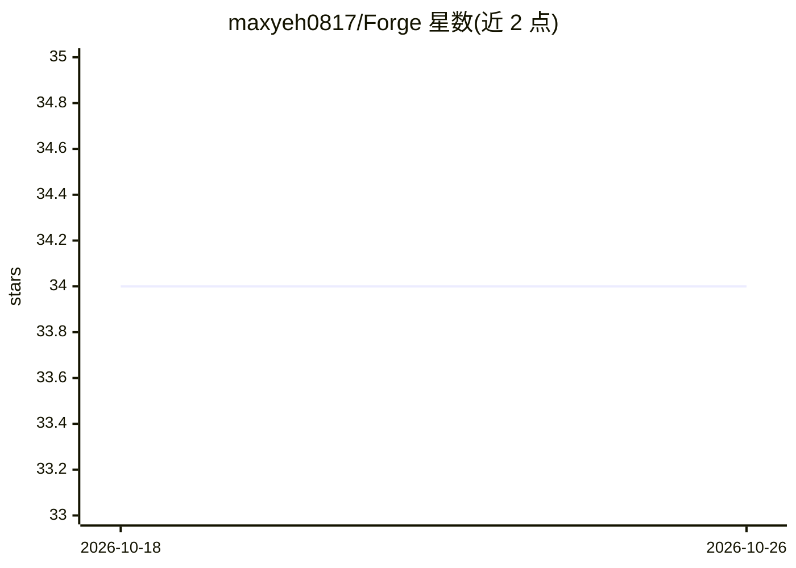

# maxyeh0817/Forge

⭐ 34 · 推送 2026-03-16 · [GitHub](https://github.com/maxyeh0817/Forge) · 个人维护 · 中文 README

**把单个 Claude Code CLI 编排为多角色 AI 开发团队的框架**

运行在 Claude Code CLI 之上的编排框架：由一个 Orchestrator 协调 PM、架构师、前端/后端工程师、QA 审查员与 DevOps 等专职 agent，覆盖需求分析、规格生成、任务分派、QA 门禁（build/lint/类型检查）与自动提交。采用双层设计分离系统层与项目数据，项目状态持久化可跨会话恢复；技能包随经验演化，含循环次数/QA 重试等安全上限。通过 git clone 后在 Claude Code 中以斜杠命令使用，可自定义新 agent。

## 筛选速览

| 维度 | 判定 | 备注 |
|---|---|---|
| AI 角色 | `ai-ecosystem` | LLM/agent 周边工具 |
| 许可风险 | `none` | — |
| 部署形态 | `library` | 以包/库形式分发 |
| 模型依赖 | locked-api |  |
| 硬件要求 | — | 无带数字的原话,不猜 |
| 安装摩擦 | `low` | 无编译、无系统依赖或容器化 |
| 成熟度 | — | 结构信号不足 |

## 能力要点

- Orchestrator 协调 PM/架构师/前后端/QA/DevOps 等专职 agent
- 任务级 QA 门禁：npm run build、lint、tsc --noEmit 与功能审查
- 项目状态持久化，跨会话从断点恢复
- 技能演化机制：模式重复出现会被提升进核心技能定义

## 适用场景

- 用自然语言描述需求，由多 agent 团队完成规划到交付
- 让 AI 生成的代码经过 QA 审查后再提交
- 跨多个会话持续推进同一开发项目

## 场景标签

`多智能体` `编码 Agent` · 领域:Agent 开发

## 证据(README 行号)

> L19: Forge is an **orchestration framework** that runs on top of Claude Code CLI. It turns a single AI assistant into a 
> L44: - Claude Code CLI installed and configured

## 星数曲线

2026-10-18 34 → 2026-10-26 34（+0）

---
*卡片 v1 · prompt 1.4 · 生成 2026-10-25 · 置信度 mid · 依据 README sha `80ef311f8727` · [字段定义](../../DATASET.md)*
