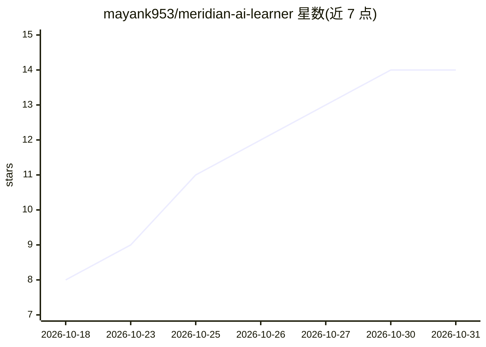

# mayank953/meridian-ai-learner

⭐ 14 · TypeScript · 推送 2026-10-25 · [GitHub](https://github.com/mayank953/meridian-ai-learner) · 个人维护

**面向学习者的双功能 AI Web 应用：文档问答与采购审计**

教学性质的 Web 应用，包含两个功能：上传 PDF（政策、合同、报告）后用自然语言提问，应用仅依据文档内容作答（RAG：Gemini 嵌入 + Chroma/Vertex AI Vector Search 检索）；以及粘贴采购请求，由风险、税务、会计三个 AI agent 分别审查，最后由 CFO 步骤生成一份带决定的备忘录。审计检查基于模型通用知识（仅汇率使用实时数据源），README 明确声明这是演示系统而非真实合规工具。技术栈为 React + FastAPI + LangChain + Gemini，通过 APP_MODE 开关在本地与 Google Cloud 两种模式间切换。

## 筛选速览

| 维度 | 判定 | 备注 |
|---|---|---|
| AI 角色 | `ai-native` | 本体是模型或模型工具 |
| 许可风险 | `none` | — |
| 部署形态 | `self-host` | docker 或自建部署 |
| 模型依赖 | — | README 未给出锁定关系 |
| 硬件要求 | — | 无带数字的原话,不猜 |
| 安装摩擦 | `low` | 无编译、无系统依赖或容器化 |
| 成熟度 | — | 结构信号不足 |

## 能力要点

- RAG 文档问答：仅基于上传 PDF 内容回答，未命中时回答不知道
- 三 agent（风险/税务/会计）+ CFO 步骤的采购审计流水线，输出 approved/conditional hold/rejected 决定
- APP_MODE 一个开关切换本地（Chroma）与云端（Vertex AI Vector Search）模式
- 配套 docs/ 教学文档、17 个无需网络的 pytest 测试与 Docker/GCP 部署路径

## 适用场景

- 学习 FastAPI、RAG、多 agent 与云部署的完整工程结构
- 在本地仅凭免费 Gemini API key 跑通文档问答与采购审计示例
- 作为模板部署到 Google Cloud（Cloud Run + Vertex AI Vector Search）

## 场景标签

`文档问答` `多智能体` · 领域:Agent 开发

## 证据(README 行号)

> L5: 1. **Ask questions about your documents.** Upload PDFs (policies, contracts, reports), then ask in plain English. Th
> L6: 2. **Check a purchase before paying.** Paste a purchase request. Three AI "specialists" review it (risk, tax, accoun
> L80: 2. The *risk*, *tax* and *control* agents each read it. Each one decides which tools to use (for example, "check th

## 星数曲线

2026-10-18 8 → 2026-10-31 14（+6）

---
*卡片 v1 · prompt 1.4 · 生成 2026-10-31 · 置信度 mid · 依据 README sha `ccb800ecb3cb` · [字段定义](../../DATASET.md)*
