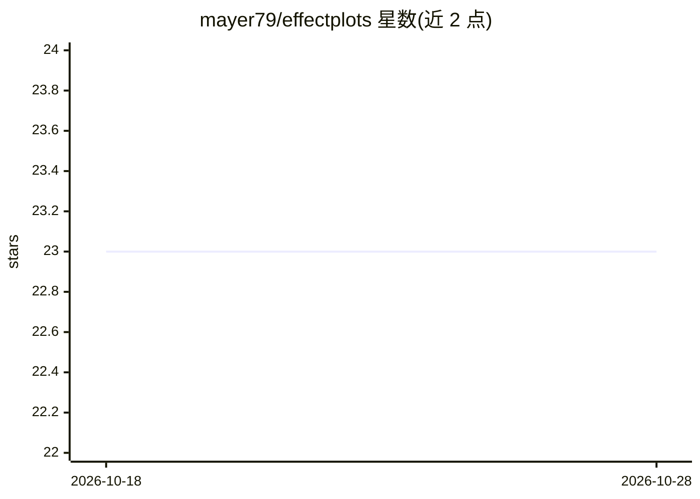

# mayer79/effectplots

⭐ 23 · R · GPL-3.0 · 推送 2025-12-29 · [GitHub](https://github.com/mayer79/effectplots) · [官网](https://mayer79.github.io/effectplots/) · 个人维护

**R 包：快速计算并绘制任意模型的特征效应图**

面向建模者的 R 包：对任意模型按特征逐一计算平均观测值、平均预测、部分依赖（PD）、累积局部效应（ALE），以及计数、权重和、平均残差等统计量，均支持样本权重；基于 {collapse} 实现高速度（普通笔记本 1 千万行 10 特征约 1 秒）。工作流为计算→update（合并稀有水平、按重要性排序）→plot（ggplot2/plotly）。多数模型开箱即用，含 DALEX 与 Tidymodels 示例，也可自定义预测函数；数值特征默认对离群值封顶。

## 筛选速览

| 维度 | 判定 | 备注 |
|---|---|---|
| AI 角色 | `ai-ecosystem` | LLM/agent 周边工具 |
| 许可风险 | `viral` | GPL-3.0 |
| 部署形态 | `None` |  |
| 模型依赖 | — | README 未给出锁定关系 |
| 硬件要求 | — | 无带数字的原话,不猜 |
| 安装摩擦 | `low` | 无编译、无系统依赖或容器化 |
| 成熟度 | — | 结构信号不足 |

## 能力要点

- 计算 PD/ALE/平均预测/平均观测等特征效应统计量
- 基于 {collapse}，千万行级数据秒级计算
- 支持样本权重与离群值封顶（可关闭）
- 兼容 DALEX explainers、Tidymodels，支持自定义预测函数

## 适用场景

- 建模前研究特征与响应的描述性关联
- 建模后用 PD/ALE 检查模型主效应与偏差
- 对比不同模型、训练/测试集或子群的特征效应

## 场景标签

 · 领域:机器学习可解释性

## 证据(README 行号)

> L7: **{effectplots}** is an R package for calculating and plotting feature effects of any model. It is very fast thanks 
> L13: - Partial dependence (Friedman [2]): How does the average prediction react on X, keeping other features fixed.

## 星数曲线

2026-10-18 23 → 2026-10-28 23（+0）

---
*卡片 v1 · prompt 1.4 · 生成 2026-10-27 · 置信度 high · 依据 README sha `aa46628012bc` · [字段定义](../../DATASET.md)*
