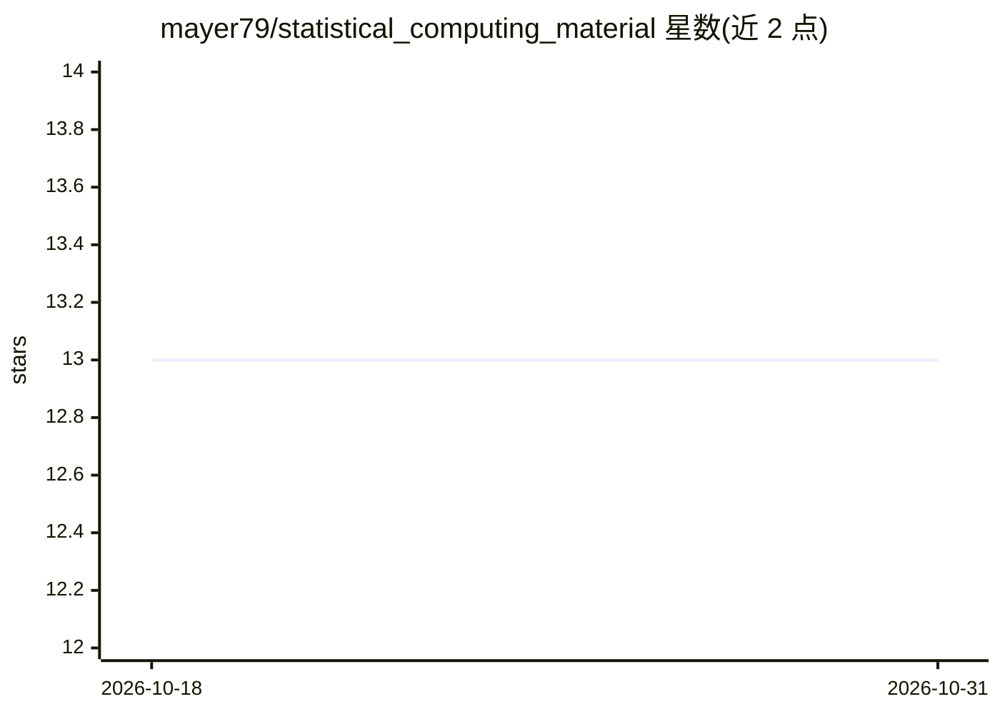

# mayer79/statistical_computing_material

⭐ 13 · TeX · 推送 2026-09-05 · [GitHub](https://github.com/mayer79/statistical_computing_material) · [官网](https://mayer79.github.io/statistical_computing_material/) · 组织维护

**统计计算课程讲义：R 语言与统计/机器学习教学材料**

Michael Mayer 在伯尔尼大学讲授的 Statistical Computing 课程讲义仓库，含六章内容：R 实操、统计推断、线性模型、模型选择与验证、树模型、神经网络，其中第 3-6 章归纳为统计机器学习实践。以 git clone 或 Zip 下载获取材料，需 R ≥ 4.6 与 RStudio，依赖 tidyverse、h2o、xgboost、lightgbm、keras3（需 Python/TensorFlow）等 R 包，部分包需 Java。附推荐书目与视频资源，采用 CC 许可分发。

## 筛选速览

| 维度 | 判定 | 备注 |
|---|---|---|
| AI 角色 | `ai-knowledge` | 知识聚合/清单类 |
| 许可风险 | `none` | — |
| 部署形态 | `None` |  |
| 模型依赖 | — | README 未给出锁定关系 |
| 硬件要求 | — | 无带数字的原话,不猜 |
| 安装摩擦 | `low` | 无编译、无系统依赖或容器化 |
| 成熟度 | — | 结构信号不足 |

## 能力要点

- 六章课程结构覆盖 R 实操到神经网络
- 依赖 h2o/xgboost/lightgbm/ranger 等建模 R 包
- 末章需 Python 与 TensorFlow（keras3::install_keras() 安装）

## 适用场景

- 跟随讲义系统学习 R 与统计机器学习
- 作为统计计算课程的配套材料
- 查找经典统计学习书目的入门参考

## 场景标签

`教程课程` · 领域:学习与行业

## 证据(README 行号)

> L97: Michael Mayer (2025), *Statistical Computing*, lecture notes, Institute of Mathematical Statistics and Actuarial Sc
> L9: The lecture has six chapters:

## 星数曲线

2026-10-18 13 → 2026-10-31 13（+0）

---
*卡片 v1 · prompt 1.4 · 生成 2026-10-31 · 置信度 high · 依据 README sha `17537fe5469c` · [字段定义](../../DATASET.md)*
